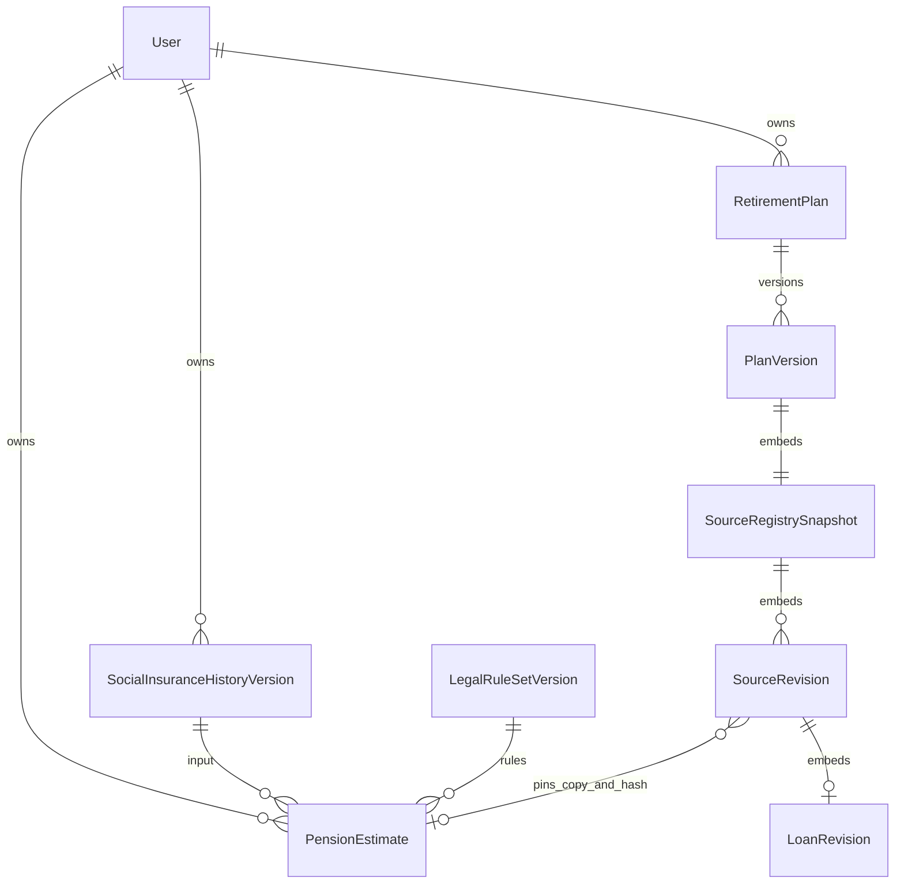

# ADR-001 — Phiên bản luật, lịch BHXH và nguồn trong kế hoạch

**07/10 — early disbursement refinance:** DISBURSED_BALANCE giải ngân trước settledOn dùng proceedsAtSettlement có xác nhận số tiền còn khả dụng/danh sách đã dùng. Đối soát net−used=available rồi available+topup=settlement+unused; không suy từ dư gốc hoặc allocations trả vay. Pin optional field trong refinance proof, không default snapshot cũ, không tạo fund movement/migration. Giải ngân sau tất toán và sử dụng khác cùng ngày cần luồng/thứ tự riêng; chưa hỗ trợ. Contract LOAN_REVISIONS_V2.

**07/10 — responsibility amendment:** loanRevisions nhận metadata sửa nghĩa vụ có ngày/chứng từ/openingUserPaid; contract.userPaidToDate giữ tổng đã thực trả kể cả ALLOCATED_SHARE để không reset khi quay lại CAPPED. Khi đã có ledger, mỗi revision phải mang tiếp và cộng allocations mới; CAPPED previouslyPaid phải khớp. Pin trong proof JSONB hiện có, không default vào bản cũ, không migration hoặc thay loan v1. Chỉ lịch sau cutoff đổi, không thêm debit/refund. Contract LOAN_REVISIONS_V2.md và FE-T15-RESPONSIBILITY-AMENDMENT; không đồng nghĩa xác nhận pháp lý/ngân hàng trực tuyến.

**07/10 — capital availability:** optional releases trong STAGED, không default vào snapshot cũ. Ledger ngoài quỹ có CONFIRMED/EXPECTED và chứng từ, tổng <= net source share; actual dùng prefix CONFIRMED theo ngày, forecast dùng prefix theo cuối tháng. CONFIRMED bất biến qua revision, không bỏ ledger; EXPECTED quá cutoff phải xử lý. Source proof hiện có pin/replay toàn bộ metadata; không thêm bảng hoặc cộng tiền nhận vào anchor.

**07/10 — STAGED:** nhiều đợt góp cùng nguồn dùng tổng lũy kế; allocations mỗi command là delta, priorRealized server tổng hợp theo sourceId và pin vào proof chỉ cho STAGED. Reader kiểm ledger toàn nguồn và lịch sử riêng, trường thiếu bị từ chối; không default vào snapshot cũ. Số nhận không cộng lại anchor. Sau STAGED tiếp tục cùng chế độ hoặc END; REALIZED v4 có thể nâng sang STAGED với khoản cũ trong hạn mức. Không migration.

**07/10 — rental lifecycle:** giữ cùng ASSET_CAPITAL sourceId khi RENT→SALE; revision chứa phần thuê còn lại và khoản góp bán, rentalExit pin cùng assetSources. Không tạo nguồn thứ hai cùng tài sản; income linked không tái sinh. Chỉ sửa tương lai, tháng kết thúc đã qua cutoff bất biến trong revision sau; actual riêng. Không migration/profile mutation. Contract ASSET_SOURCES_V4.md.

**07/10 — missedContribution:** thêm metadata tùy chọn trên asset REVISE, không default cho snapshot cũ. Lịch gần nhất + actual revision + chứng từ được pin cùng assetSources; candidate chỉ sửa tương lai, không sửa anchor hoặc dữ liệu hồ sơ. Lịch cũ giữ để replay. Chỉ toàn bộ chưa góp, partial/multiple contributions còn mở. Không migration. Contract ASSET_SOURCES_V4.md.

**07/10 runtime:** loanCreations/refinances thực tế và assetCommands đã nối cùng API source-reforecasts; evidence giữ newLoanSources/refinances/assetSources trong JSONB PlanVersion, không thêm bảng. Loan19/refinance20/asset20 HTTP/DB rollback đạt; cổng duyệt cũ đã phục hồi, không còn chặn các lượt này. Refinance tương lai, RENT→SALE, các nhánh BHXH/race/UI/vận hành còn mở. Contracts ASSET_SOURCES_V4.md/LOAN_REVISIONS_V2.md thay mô tả chưa mở chức năng trong checkpoint cũ.

**06/10 — T15 public:** `loanRevisions` đã nối vào cùng API source-reforecasts, tối đa30/batch, save/apply tách riêng. Chuyển v1 chỉ xác nhận basis số dư bằng `legacyOpening` và giữ lịch gốc, không giả lập lịch v2 lịch sử. V2 giữ trong `loanSources` của snapshot cùng toàn bộ actual/consumed server lấy theo chủ; reader kiểm chain/proof/lịch, apply kiểm revision actual. Preview trả `loanRevisionOptions` để UI dùng hash server. CAPPED phải xác nhận trần tổng payments và mang phần đã trả; không tự đổi trần hoặc loại. [LOAN_REVISIONS_V2.md](LOAN_REVISIONS_V2.md) là contract hiện hành. Refinance/tài sản/vay mới và PostgreSQL/races vẫn còn làm; các ghi chú chưa mở T15 bên dưới là lịch sử.

**Cập nhật runtime05/10 — v4:** đã mở preview/save tại `plans/{planId}/source-reforecasts`, reader/apply/report/CSV/AI và actual forecast nhận snapshot v4. Phạm vi CREATE/REVISE/END thu/chi/pension, chọn estimate BHXH; tài sản/vốn/vay mới chưa mở. Contract cụ thể [SOURCE_COMMANDS_V4.md](SOURCE_COMMANDS_V4.md) thay đường dẫn v4 dự kiến bên dưới. CAS dùng expectedSnapshotHash + plan/source revisions (snapshot đã pin sourceHash); sourceId mới có tiền tố `plan:`; giới hạn batch100flow+1estimate. Dòng tiền là VND danh nghĩa mỗi tháng, chưa có FX/price-basis khác. Cho revision cùng tháng bắt đầu khi sau cutoff. Evidence estimate/command lưu trong preview của snapshot và được kiểm lại khi đọc/replay. Các câu “v4 nội bộ/chưa mở” dưới đây là lịch sử thiết kế, không là trạng thái runtime hiện hành. PostgreSQL/race còn chờ kiểm chứng.

**Cập nhật triển khai05/10:** migration0011 rules/history/estimates đã áp dụng; APIs history/legal-rules/estimates ở insurance.openapi.yaml. Thêm authorIds để mọi người từng sửa draft đều không được tự review. BH1 thường đã có engine/strategy; chưa có corpus luật thật PUBLISHED. Core registry dùng knownOn theo ngày và originHash; source-snapshot.openapi.yaml mô tả financialv4 nội bộ. Publicv4/loanrevision chưa mở. Các câu “chưaDDL” dưới đây là quyết định thiết kế ban đầu, được cập nhật bởi INSURANCE_HISTORY_RULES.md/PROGRESS.md.

Ngày 05/10/2026. **Chốt thiết kế T13-02; chưa áp dụng DDL và chưa mở các API mở rộng.** Contract thiết kế ở [expansion.openapi.yaml](expansion.openapi.yaml), tách khỏi OpenAPI production để frontend không gọi nhầm. Căn cứ được rà ở [LEGAL_RULE_MATRIX.md](LEGAL_RULE_MATRIX.md).

## Quyết định lưu trữ

Thêm ba bảng ở T14. Registry nguồn và revision khoản vay của từng phương án lưu trong JSONB bất biến của `PlanVersion`, không tạo bảng nguồn toàn tài khoản trong đợt này. Lý do: nguồn tạo ở phương án A không được tự xuất hiện ở phương án B hoặc hồ sơ; phiên bản kế tiếp lấy registry của phiên bản cha. JSONB phù hợp dữ liệu đóng gói để replay, nhưng mọi reference/hash/CAS phải kiểm bằng service trong transaction vì DB không có FK tới từng phần tử JSON.

| Bảng mới | Cột và ràng buộc chính | Bất biến/quyền |
| --- | --- | --- |
| `legal_rule_set_versions` | UUID id; code/version unique; revision>=1; status DRAFT/VALIDATED/REVIEWED/PUBLISHED; effectiveFrom, effectiveTo nullable (exclusive); knowledgeAsOf; document JSONB, documentHash; validation/review JSONB nullable; createdBy/reviewedBy/publishedBy; publishedAt, createdAt | ADMIN. Sửa draft tăng revision và xóa validation/review. Published không sửa/xóa; bản thay thế tạo version mới. Dữ liệu luật độc lập tài khoản khách |
| `social_insurance_history_versions` | UUID id; userId FK CASCADE; revision>=1 unique(userId,revision); parentVersionId nullable; parentHash; recordedAt; schemaVersion=1; document JSONB, documentHash | USER sở hữu. Append-only, không PATCH bản cũ. Đọc latest trong transaction khóa hàng User rồi so expectedHistoryRevision; hai request cùng revision chỉ một thắng. Không tăng revision bảo mật của User |
| `pension_estimates` | UUID id; userId FK CASCADE; historyVersionId; legalRuleSetVersionId; engineCode; inputHash; inputSnapshot/result JSONB; integrityHash; createdAt | USER sở hữu. FK history + userId kiểm cùng chủ bằng composite unique/FK; rule FK RESTRICT; estimate chỉ tham chiếu rule published. Snapshot chứa đầy đủ rules/history cần replay, không đọc lại dữ liệu mutable |

`parentVersionId` lịch sử chỉ trỏ bản trước cùng user bằng composite FK, không trỏ tương lai/vòng. Không có API xóa từng revision đã được dùng; xóa tài khoản xóa toàn bộ history/estimate của tài khoản trong cùng transaction. Estimate FK history dùng CASCADE cho luồng xóa tài khoản; không ảnh hưởng luật công khai. Registry trong plan chỉ pin estimate của cùng chủ; khi xóa tài khoản các plans cũng theo chính sách xóa hiện có. Không dùng retention AI để xóa lịch tài chính.

`effectiveFrom/effectiveTo` là khoảng luật áp dụng; `knowledgeAsOf` là thời điểm hệ thống ghi nhận tài liệu; `publishedAt` là thời điểm cho phép dùng. Chọn rule theo nhóm + thời điểm nghiệp vụ + kiến thức đã công bố, không theo `createdAt` lớn nhất. Publish khóa theo code/coverage, từ chối overlap không có quan hệ supersedes rõ. Khi thay luật cho phép supersede bằng bản mới, không sửa cửa sổ của bản đã pin. Nếu nhiều bản cùng hợp lệ mà không xác định được thứ tự thì REVIEW_REQUIRED.

Các cạnh tới thành phần snapshot là liên kết logic, không là FK/bảng vật lý mới. Không thêm bảng `SourceRevision`, `LoanRevision` hoặc `SourceRegistrySnapshot` trong migration.

## Document luật và lịch đóng

- Rule document chứa schemaVersion, engineCode, các coverage branch tách nhỏ, citation với điều/trang/hash, bảng tuổi/hệ số/mức tham chiếu/lãi suất theo loại + năm + hiệu lực. Không lưu chuỗi JavaScript hoặc biểu thức do AI tạo để thực thi. Engine chỉ gọi strategy đã đăng ký trong code.
- Validation do server tạo: documentHash, engineCode, fixture-suite hash, từng case expected/actual, coverage đạt/thiếu. REVIEWED phải trỏ đúng validation; publish kiểm lại hash/revision, người có quyền rà và không cho người soạn tự duyệt. Sửa nội dung sau review làm review vô hiệu. Thiếu luật/bảng/fixture của nhánh nào thì không publish hỗ trợ nhánh đó.
- Lịch BHXH giữ tháng, scheme, salaryRegime, contributionBase, status PAID/CREDITED/UNKNOWN/WITHDRAWN và evidence. CREDITED cần loại/căn cứ; UNKNOWN không quy thành 0 tháng đã đóng. Khoảng lịch khai `coverageFrom/coverageThrough` cho phép chỉ ra khoảng trống; mọi tháng trong khoảng cần một entry (UNKNOWN được phép lưu, chưa đủ để tính). Một tháng không được đếm hai lần khi đổi chế độ/nhiều hợp đồng. Có `confirmedThroughMonth` tách lịch sử và future projection.
- Ngày sinh có precision DAY/MONTH/YEAR/UNKNOWN; quy ước pháp lý chỉ áp trong đầu vào tính và có citation. Không ghi ngày quy ước ngược vào personal profile. Lưu nhóm nghề/địa bàn/chế độ và evidence theo khoảng; chưa hỗ trợ trả REVIEW_REQUIRED.
- Import chỉ parse dữ liệu có cấu trúc → trả lỗi/preview → người dùng xác nhận bằng expectedHash/revision → append. Không nạp URL/Excel macro, không tự gửi hồ sơ cho AI. Giới hạn 1.200 tháng và body size hiện có; file lớn tách luồng upload có thiết kế riêng.
- Estimate trả assessmentStatus, estimateKind, missingFields, coverage, breakdown và citations. Tiền là Decimal string/null. Lịch future riêng; năm chưa có hệ số công bố không được ngầm dùng hệ số gần nhất. Lưu estimate không sửa pension hồ sơ hoặc plan; chọn vào candidate là command riêng.

## Registry nguồn và changeset

Registry `schemaVersion=1` được pin trong format snapshot mới `retirement-plan-snapshot-v2`, model `retirement-monthly-v4` (reserved, chưa đăng ký runtime). Envelope có owner/plan lineage do server cấp, `anchorThroughMonth`, `knowledgeAsOf`, sources, allocations và hash. Nguồn là identity ổn định + chuỗi revision bất biến, không chỉ map số tiền hiện tại.

- ID profile: `profile:income:<id>`, `profile:expense:<id>`, `profile:pension`, `profile:debt:<id>`, `profile:asset:<id>`; nguồn mới `plan:<uuid>` do client tạo cho retry, server kiểm uniqueness trong lineage/owner. Label không là ID. `scope=PLAN_VERSION` cho mọi sửa nguồn trong phương án; provenance nói nguồn bắt đầu từ profile nào/revision nào.
- Revision giữ `sourceId`, revision, previousHash, effectiveFromMonth/effectiveToMonth (inclusive), recordedAt, kind, origin, confirmation, evidence và payloadHash. Không đổi kind hoặc identity qua REVISE. Không có backfill tự động dữ liệu lịch sử.
- CREATE chỉ ID chưa tồn tại; REVISE/END cần expectedSourceRevision, expectedSourceHash. Một changeset tối đa 200 command; mỗi source tối đa một command, id command không lặp trong lineage. END hiệu lực từ đầu tháng được chỉ định (không tạo dòng kể từ tháng đó), giữ lịch cũ. Khoảng payload là inclusive; bộ dựng lịch cắt revision trước tại tháng liền trước revision sau. Không cho revision mới sửa phần <= cutoff actual.
- Payload theo kind INCOME/EXPENSE/PENSION/ASSET_CAPITAL/DEBT. Mọi số tiền có currency VND, priceBasis và basisMonth; không tự FX. ONE_OFF có đúng một tháng; RECURRING có khoảng. Nguồn ASSET_CAPITAL chỉ bơm `confirmedContributionAmount <= netAvailable` vào quỹ theo thời điểm thực có sẵn. DEBT không là INCOME; khoản giải ngân không tự tăng quỹ. Pension có liên kết thay thế income pension hoặc estimate, không thêm trùng nguồn.
- Tạo/thay nguồn mới chưa có xử lý tương ứng phải reject, không silently ignore. Nguồn hiện có từ v3 phải được chuyển thành từng lịch có attribution và baseline reconciliation, không suy bằng tên. Phần chi hưu mục tiêu/rent/capital/reserve cũng phải có nguồn tổng hợp rõ ràng; tổng từng nhóm = tổng tháng chính xác Decimal.
- `futureChanges` cũ vẫn đọc được. Khi nâng sang v4, vùng đã override tổng được lưu như aggregate override có lineage, không biến thành nguồn giả không truy được. Từ chối overlap cùng metric/tháng với source command; không cộng/trừ thứ tự tùy ý.

## Khoản vay và bằng chứng tiền đã trả

LoanRevision có contractVersion=2, signedOn/amendedOn/effectiveOn/knownOn, previousRevision/hash, balanceAsOf, scope FULL_CONTRACT/USER_SHARE, principalBalance, confirmation HYPOTHETICAL/BANK_CONFIRMED và evidence. Giữ Contractv1 nguyên trạng để đọc bản cũ, không đổi enum effect cũ để giả hỗ trợ phương án mới.

`payments[]` có eventId/actualRevision và principal/interest/prepaymentFee/otherFee cùng scope. Tổng allocation theo event không vượt amount và không reuse allocation trong chuỗi; liên kết đúng DEBT_PAYMENT của chủ, đã nằm trong tháng reconciled. Kiểm dư gốc trước − trả gốc + tăng gốc được xác nhận = dư gốc sau, sai trả DEBT_BALANCE_MISMATCH. Không suy phần người đồng vay đã trả từ USER_SHARE.

Schedule mode REDUCE_PAYMENT_KEEP_TERM / REDUCE_TERM_KEEP_PAYMENT / BANK_SCHEDULE / RESTRUCTURED / REFINANCED, chỉ enabled khi strategy và fixtures đã có. Giữa kỳ cần quy ước ngày/lãi và ngày ghi sổ; thiếu thì REVIEW_REQUIRED hoặc yêu cầu BANK_SCHEDULE. Lãi/phí không tự vốn hóa. Refinance là changeset atomic đóng nguồn cũ/tạo nguồn nợ mới, kiểm luồng tiền giải ngân–tất toán–phí; không tự thành thu nhập/quỹ.

WITHDRAWAL đã giảm quỹ ở actual anchor thì DEBT_PAYMENT/allocation không trừ lần hai. Contract/evidence sửa khiến save/apply stale nhưng không thay snapshot cũ. Mức CAPPED cần theo dõi phần nghĩa vụ đã thực hiện, không reset cap mỗi revision. Luật chuyển tiếp khoản vay dùng ma trận T13-01 và điều khoản thực, không dùng chatbot quyết định.

## API, transaction và tương thích

Contract thiết kế xác định nhóm endpoint admin legal-rules; me pension/history/import-preview; me pension/estimates/preview và save; me actuals/reforecast-v4/preview và plans/:id/reforecasts-v4/save. Tách v4 command khỏi endpoint v3 để không vô tình đổi nghĩa body/hash cũ. Save/apply cần Idempotency-Key, expected plan/profile/history/source revisions, preview hash; chủ tài khoản lấy từ auth, không nhận userId tùy ý. ADMIN quản trị luật, không tự đọc lịch BHXH của khách qua route USER.

Preview chỉ đọc. Save đọc lại tất cả input trong transaction, kiểm actual lineage/ownership/rule published/hash/effective interval/knowledge cutoff rồi tính lại; mismatched hash trả409. Cùng key/body trả bản cũ; cùng key/body khác trả409. Apply vẫn riêng và kiểm stale; baseline và lịch sử không đổi. Không gọi Gemini hoặc mạng trong transaction tính tài chính.

T13-03 phải bổ sung dispatcher **theo cả format và model**; không nới whitelist chấp nhận v4 rồi cho chạy engine v3. Reader cũ tiếp tục đọc format v1/model v2/v3 byte-for-byte. V4 replay chạy trên snapshot đầy đủ, không tra bảng luật mới/profile mới. Nâng v3→v4 là candidate mới và bắt buộc so no-op rows/summary, không ghi lại hash của version cũ. Existing endpoint simulation/report/CSV/AI chỉ nhận v4 khi đã xử lý attribution và đầu ra mới.

## Migration và nghiệm thu

T14-01/02 mới viết migration kế tiếp (sau0010; kiểm tên mới nhất ngay lúc tạo), chỉ CREATE TABLE/index/FK/check. Không seed luật PUBLISHED, không backfill 50 hồ sơ thành lịch đóng giả. Tiền trong JSON giữ chuỗi, tiền cột nếu có dùng Decimal(18,2). Thời điểm pháp lý dùng date, thời điểm ghi nhận dùng timestamptz. CHECK trạng thái/date/revision/hash, unique và composite owner FK bổ sung bằng SQL nếu Prisma chưa biểu diễn đủ.

Trước apply: checksum/schema audit chỉ đọc → DDL trong transaction rollback trên DB thật → clean install/upgrade trên DB tạm → deploy hẹp nếu đạt → fingerprint dữ liệu cũ. Không sửa migration đã áp dụng, reset DB, seed hoặc gửi email. Nếu API chưa được triển khai thì không đưa spec thiết kế vào tài liệu production.

Nghiệm thu T13-02 là quyết định dữ liệu/contract và spec hợp lệ; **không** là nghiệm thu persistence/authorization/runtime. Các ca T14–T17 bắt buộc: history trùng/thiếu, rule thiếu/overlap/review stale, wrong owner, races/idempotency, no-op v3→v4, tổng attribution, hash JSONB reorder, loan allocation không trùng, replay sau sửa luật/actual/profile. DB có ba bảng mới chỉ được báo hoàn thành sau migration/checks thực chạy.
