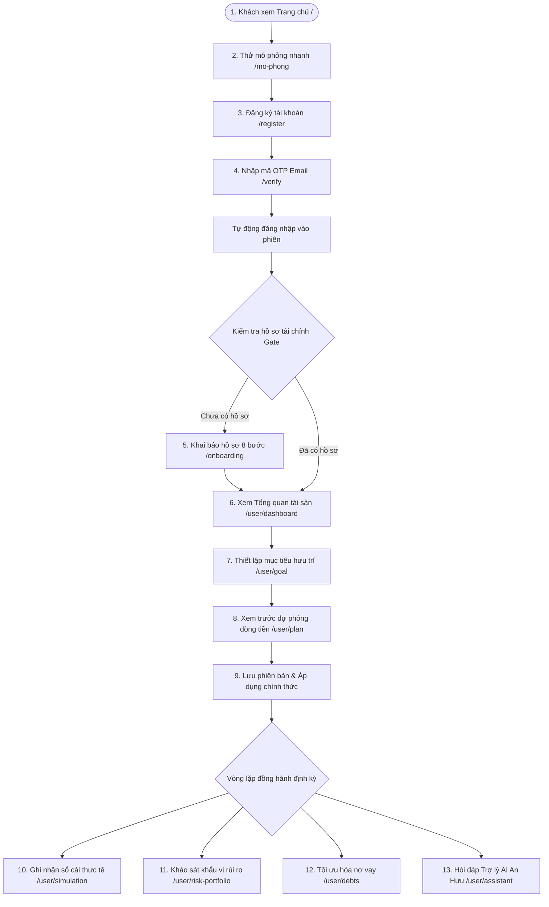
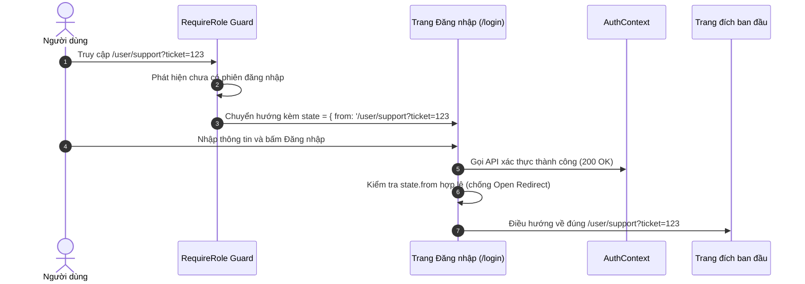
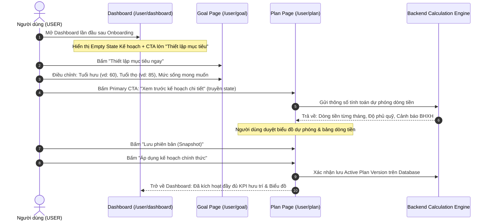
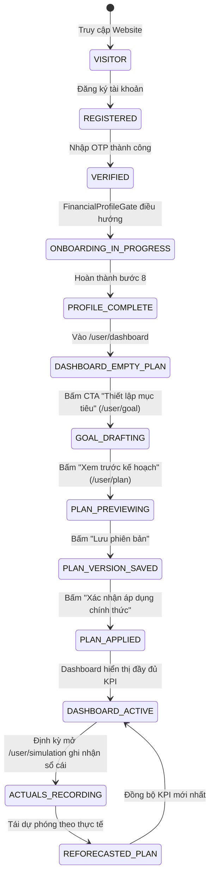

# BÁO CÁO TOÀN DIỆN: LUỒNG HOẠT ĐỘNG CỦA NGƯỜI DÙNG VÀ CHỨC NĂNG TỪNG TRANG HỆ THỐNG AN HƯU

> **Tài liệu đặc tả hệ thống & Hành trình trải nghiệm người dùng (Product Specification & User Journey Report)**  
> **Dự án:** An Hưu — Nền tảng Hoạch định Tài chính Hưu trí & Dòng tiền Dài hạn  
> **Phiên bản:** 2.0 (Official Release)  
> **Ngày lập báo cáo:** 12/10/2026  
> **Ngôn ngữ:** Tiếng Việt  

---

## MỤC LỤC
1. [I. Tổng quan hệ thống & Triết lý vận hành](#i-tổng-quan-hệ-thống--triết-lý-vận-hành)
2. [II. Bản đồ luồng hoạt động của User (User Journey Flows)](#ii-bản-đồ-luồng-hoạt-động-của-user-user-journey-flows)
   - [1. Luồng tổng thể xuyên suốt (Happy Path)](#1-luồng-tổng-thể-xuyên-suốt-happy-path)
   - [2. Luồng Khám phá & Trải nghiệm công khai](#2-luồng-khám-phá--trải-nghiệm-công-khai-public-discovery-flow)
   - [3. Luồng Xác thực & Bảo toàn ngữ cảnh (Auth Redirect)](#3-luồng-xác-thực--bảo-toàn-ngữ-cảnh-auth-redirect-flow)
   - [4. Luồng Khai báo hồ sơ tài chính (Onboarding 8 bước)](#4-luồng-khai-báo-hồ-sơ-tài-chính-onboarding-flow)
   - [5. Vòng lặp hoạch định hưu trí cốt lõi (Core Planning Loop)](#5-vòng-lặp-hoạch-định-hưu-trí-cốt-lõi-core-planning-loop)
   - [6. Luồng Theo dõi thực tế & Tái dự phóng (Actuals & Reforecast)](#6-luồng-theo-dõi-thực-tế--tái-dự-phóng-actuals--reforecast-flow)
   - [7. Luồng Tối ưu hóa nợ & Khảo sát rủi ro đầu tư](#7-luồng-tối-ưu-hóa-nợ--khảo-sát-rủi-ro-đầu-tư)
   - [8. Luồng Tương tác Trợ lý AI An Hưu](#8-luồng-tương-tác-trợ-lý-ai-an-hưu)
   - [9. Luồng Xử lý ngoại lệ, Trạng thái rỗng & Phục hồi lỗi](#9-luồng-xử-lý-ngoại-lệ-trạng-thái-rỗng--phục-hồi-lỗi)
3. [III. Bảng ánh xạ Tuyến đường & Phân quyền (Route Matrix)](#iii-bảng-ánh-xạ-tuyến-đường--phân-quyền-route-matrix)
4. [IV. Báo cáo chi tiết chức năng của từng trang (Screen-by-Screen Specification)](#iv-báo-cáo-chi-tiết-chức-năng-của-từng-trang)
   - [Phân hệ 1: Trang Công khai & Tiếp thị (Public Marketing)](#phân-hệ-1-trang-công-khai--tiếp-thị-public-marketing)
   - [Phân hệ 2: Trang Xác thực tài khoản (Authentication)](#phân-hệ-2-trang-xác-thực-tài-khoản-authentication)
   - [Phân hệ 3: Trang Khai báo hồ sơ (Onboarding)](#phân-hệ-3-trang-khai-báo-hồ-sơ-onboarding)
   - [Phân hệ 4: Phân hệ Không gian Người dùng (User Space)](#phân-hệ-4-phân-hệ-không-gian-người-dùng-user-space)
   - [Phân hệ 5: Phân hệ Quản trị hệ thống (Admin Portal)](#phân-hệ-5-phân-hệ-quản-trị-hệ-thống-admin-portal)
5. [V. Ma trận chuyển đổi trạng thái người dùng (User State Transitions)](#v-ma-trận-chuyển-đổi-trạng-thái-người-dùng-user-state-transitions)
6. [VI. Tiêu chuẩn thiết kế & Bảo đảm trải nghiệm người dùng (UX Principles)](#vi-tiêu-chuẩn-thiết-kế--bảo-đảm-trải-nghiệm-người-dùng-ux-principles)

---

## I. TỔNG QUAN HỆ THỐNG & TRIẾT LÝ VẬN HÀNH

**An Hưu** là nền tảng số hóa chuyên sâu về **Hoạch định Tài chính Hưu trí (Retirement Planning SaaS)** và **Quản trị Dòng tiền Dài hạn** dành riêng cho người Việt Nam. Khác với các ứng dụng tài chính đầu cơ hay giao dịch ngắn hạn tạo áp lực FOMO, An Hưu định hình phong cách **Bình tĩnh (Calm) — Minh bạch (Transparent) — Dài hạn (Long-term) — Độc lập 100%**:

1. **Độc lập tuyệt đối:** Không quảng cáo, không bán chéo bảo hiểm, không nhận hoa hồng phân phối sản phẩm đầu tư. Mọi khuyến nghị đều xuất phát từ quyền lợi tối cao của người dùng.
2. **Toán học & Luật định Việt Nam:** Tích hợp mô hình giá trị tiền tệ theo thời gian (TVM), hệ số trượt giá lạm phát lũy kế, và công thức ước tính quyền lợi Bảo hiểm Xã hội (BHXH) chuẩn xác theo Luật Bảo hiểm Xã hội và Bộ luật Lao động Việt Nam.
3. **Cơ chế lưu trữ đa cấp:** Đồng bộ giữa hồ sơ tài chính người dùng (`FinancialProfileContext`), kế hoạch hưu trí phiên bản hóa (`RetirementPlanContext`) và sổ cái đối soát thực tế định kỳ (`Actuals Ledger`).

Hệ thống phục vụ 3 nhóm đối tượng:
- **Khách vãng lai (Visitor):** Tiếp cận cẩm nang, tự do tính toán thử nghiệm không bắt buộc đăng nhập.
- **Người dùng cá nhân (USER):** Người sở hữu tài khoản, xây dựng và quản lý kế hoạch hưu trí dài hạn.
- **Quản trị viên (ADMIN):** Quản lý người dùng, vận hành nội dung, cấu hình tham số vĩ mô và đối tác.

---

## II. BẢN ĐỒ LUỒNG HOẠT ĐỘNG CỦA USER (USER JOURNEY FLOWS)

### 1. Luồng tổng thể xuyên suốt (Happy Path)

---

### 2. Luồng Khám phá & Trải nghiệm công khai (Public Discovery Flow)
* **Đối tượng:** Khách vãng lai chưa có tài khoản.
* **Các bước:**
  1. Người dùng truy cập trang chủ `/` tìm hiểu sứ mệnh, các bài viết cẩm nang và bản xem trước của Trợ lý AI.
  2. Bấm nút *"Khám phá mô phỏng"* chuyển tiếp đến `/mo-phong`.
  3. Kéo thanh trượt điều chỉnh: **Tuổi hiện tại** (20–55), **Tuổi nghỉ hưu mong muốn** (55–65), **Chi tiêu tháng kỳ vọng** (5–100 tr ₫).
  4. Hệ thống tính toán tức thì bằng thuật toán TVM:
     - Số tiền quỹ hưu trí cần có ở mốc nghỉ hưu.
     - Số tiền cần tích lũy tối thiểu mỗi tháng.
     - Biểu đồ tăng trưởng qua từng mốc 10 năm.
     - Bảng so sánh thiệt hại tài chính nếu trì hoãn 5 năm hoặc 10 năm.
  5. Bấm CTA *"Lưu lại kết quả này để lập kế hoạch chi tiết"* dẫn thẳng sang trang Đăng ký.

---

### 3. Luồng Xác thực & Bảo toàn ngữ cảnh (Auth Redirect Flow)
* **Nguyên tắc bảo toàn ngữ cảnh:** Không bao giờ đá văng người dùng về Dashboard nếu họ bấm từ một liên kết cụ thể (ví dụ link ticket `/user/support?ticket=123#replies`).
* **Sơ đồ xử lý:**

* **Xử lý Đăng ký & Kích hoạt:**
  - Điền form tại `/register` → Gửi mã OTP 6 số qua email → Tự chuyển sang `/verify`.
  - Nhập đúng OTP: Hệ thống tự động thiết lập phiên làm việc và chuyển tiếp ngay sang Onboarding, **không bắt đăng nhập lại tại `/login`**.

---

### 4. Luồng Khai báo hồ sơ tài chính (Onboarding Flow)
* **Cơ chế kiểm soát:** Mọi truy cập vào phân hệ `/user/*` đều qua `FinancialProfileGate`. Nếu người dùng chưa có hồ sơ tài chính, hệ thống ép chuyển hướng vào `/onboarding`.
* **Cơ chế lưu nháp bền vững (Autosave Draft):**
  - Mỗi bước khi bấm *"Tiếp tục"*, hệ thống gọi API `saveOnboardingDraft()` lưu nháp lên máy chủ.
  - Sau khi máy chủ trả về `200 OK`, giao diện mới chuyển sang bước tiếp theo.
  - Nếu mất mạng, hệ thống giữ nguyên dữ liệu vừa nhập, không mất công sức của người dùng và hiển thị nút *"Thử lại"* màu đỏ.
* **Chi tiết 8 bước:**
  1. `welcome`: Lời chào định hướng, giải thích mục đích và cam kết bảo mật.
  2. `personal`: Tuổi, giới tính, tình trạng hôn nhân, người phụ thuộc, tỉnh/thành phố.
  3. `income`: Thu nhập chính và thu nhập phụ hàng tháng.
  4. `expense`: Chi tiêu thiết yếu (cố định) và chi tiêu nâng cao (phong cách sống).
  5. `assets`: Tiền gửi tiết kiệm, bất động sản sở hữu, tài sản thanh khoản khác.
  6. `debt`: Khai báo nợ (vay mua nhà, nợ tiêu dùng, nghĩa vụ trả nợ gốc + lãi mỗi tháng).
  7. `invest-social`: Cổ phiếu/quỹ đầu tư, số năm tham gia BHXH và mức lương đóng BHXH bình quân.
  8. `summary`: Tổng kết Tài sản ròng (Net Worth), Thặng dư tích lũy hàng tháng và phân tích sức khỏe tài chính sơ bộ. Bấm *"Hoàn tất hồ sơ"* để giải phóng Gate và chuyển vào Dashboard.

---

### 5. Vòng lặp hoạch định hưu trí cốt lõi (Core Planning Loop)
Đây là "trái tim" của hệ thống An Hưu, kết nối chặt chẽ giữa 3 màn hình: **Dashboard → Goal → Plan**.

* **Nguyên tắc nghiệp vụ quan trọng:**
  - **Goal không tự ý sửa Profile:** Người dùng chỉnh "Chi tiêu giả định ở tuổi hưu" trên trang Goal không làm ảnh hưởng đến "Chi tiêu sinh hoạt hiện tại" trong Hồ sơ.
  - **Tính đầy đủ của thời hạn dự phóng (Horizon Completeness):** Hệ thống dự phóng xuyên suốt từ hiện tại đến hết tuổi thọ kỳ vọng (80–85 tuổi). Tuyệt đối không tự ý cắt ngắn năm dự phóng theo thời hạn ngắn hạn của danh mục để báo "đạt mục tiêu giả".

---

### 6. Luồng Theo dõi thực tế & Tái dự phóng (Actuals & Reforecast Flow)
* **Mục đích:** Đảm bảo kế hoạch không phải là một tài liệu tĩnh mà liên tục đồng hành cùng đời sống tài chính thực tế.
* **Quy trình định kỳ hàng tháng:**
  1. Người dùng vào `/user/simulation`, mở tab **Sổ cái thực tế (Actuals Ledger)**.
  2. Khai báo số liệu thực tế của tháng hiện tại `[YYYY-MM]`: Thu nhập thực nhận, chi tiêu thực tế, số tiền đã gửi vào tích lũy/đầu tư.
  3. Hệ thống đối soát tự động: Tính chênh lệch thặng dư/thâm hụt giữa Kế hoạch lý thuyết và Thực tế thực hiện.
  4. Bấm nút **"Tái dự phóng (Reforecast)"**: Thuật toán tính toán lại toàn bộ lộ trình dòng tiền tương lai bắt đầu từ số dư thực tế mới nhất.

---

### 7. Luồng Tối ưu hóa nợ & Khảo sát rủi ro đầu tư

#### A. Luồng Tối ưu hóa nợ (`/user/debts`)
- Người dùng quản lý danh mục các khoản nợ vay (Bất động sản, Xe cộ, Thẻ tín dụng, Khoản vay cá nhân).
- Hệ thống phân tích chi phí cơ hội của tiền lãi và tự động tính toán 2 chiến lược:
  - **Tuyết lở (Avalanche):** Tập trung dồn ngân sách trả hết khoản vay có lãi suất cao nhất trước → Tiết kiệm tối đa tiền lãi.
  - **Tuyết lăn (Snowball):** Tập trung trả hết khoản nợ có dư nợ nhỏ nhất trước → Giải tỏa áp lực tâm lý nhanh chóng.
- Hệ thống hiển thị số tiền thặng dư hàng tháng được giải phóng sau khi hết nợ và liên kết ngược sang trang Plan để tái cân bằng quỹ hưu trí.

#### B. Luồng Khảo sát khẩu vị rủi ro (`/user/risk-portfolio`)
- Người dùng trả lời bài trắc nghiệm trắc lượng tài chính theo 6 chiều đo: Mục tiêu, Thời gian nắm giữ, Thanh khoản, Chịu lỗ, Kinh nghiệm và Năng lực tài chính.
- Hệ thống phân loại hồ sơ rủi ro: **Thận trọng (Conservative)**, **Cân bằng (Balanced)**, **Tăng trưởng (Growth)**.
- Gợi ý cơ cấu phân bổ 3 rổ tài sản:
  - *Rổ An toàn:* Tiền gửi ngân hàng, chứng chỉ tiền gửi.
  - *Rổ Bảo toàn & Tích lũy:* Trái phiếu, bất động sản tạo dòng tiền.
  - *Rổ Tăng trưởng:* Quỹ mở cổ phiếu, quỹ chỉ số ETF.
- **Bảo mật UX:** Dữ liệu khảo sát được cô lập theo từng `user.id` riêng biệt, không lưu chung key localStorage giữa các tài khoản dùng chung thiết bị.

---

### 8. Luồng Tương tác Trợ lý AI An Hưu (`/user/assistant`)
- Quản lý đa hội thoại: Người dùng có thể tạo nhiều chủ đề thảo luận riêng biệt, đổi tên, tra cứu lịch sử hoặc xuất file hội thoại.
- Cơ chế giải đáp có căn cứ (Grounded AI):
  - Đọc trực tiếp số liệu từ hồ sơ tài chính và kế hoạch hưu trí đang áp dụng.
  - Gắn kèm các huy hiệu minh bạch:
    - `Facts`: Các con số thực tế được trích từ hồ sơ của chính người dùng.
    - `Citations`: Điều luật BHXH, công văn chính sách hoặc nguyên tắc tài chính đối chiếu.
    - `Provenance`: Nguồn gốc thuật toán và công thức tính toán.
- Bảng cài đặt quyền riêng tư: Cho phép người dùng bật/tắt quyền AI tiếp cận dữ liệu tài chính cá nhân.

---

### 9. Luồng Xử lý ngoại lệ, Trạng thái rỗng & Phục hồi lỗi

| Tình huống ngoại lệ | Hành vi hệ thống yêu cầu | Trải nghiệm người dùng | Hướng khắc phục |
|---|---|---|---|
| **Chưa có kế hoạch (Empty Plan)** | Dashboard không hiển thị số liệu 0 ₫ vô nghĩa hay biểu đồ trắng. | Hiển thị Banner chào mừng định hướng: Tóm tắt Net Worth + Lời khuyên bước đi đầu tiên. | Nút Primary CTA lớn: *"Thiết lập mục tiêu hưu trí ngay"* dẫn sang `/user/goal`. |
| **Không có thặng dư (Thu nhập = Chi tiêu hoặc Âm tiền)** | Chấp nhận giá trị `0 ₫`, tuyệt đối không tự động bịa số tích lũy giả. | Hiển thị cảnh báo nhẹ nhàng: *"Hiện bạn chưa có thặng dư hàng tháng để tích lũy hưu trí"*. | Gợi ý liên kết đến `/user/debts` để tối ưu chi phí trả nợ và cắt giảm chi tiêu. |
| **Mất kết nối mạng khi đang thao tác** | Giữ nguyên dữ liệu trong bộ nhớ tạm, không chuyển trang; nút bấm chuyển sang màu đỏ. | Hiển thị thông báo: *"Mất kết nối mạng. Dữ liệu của bạn vẫn an toàn trên máy"*. | Nút bấm đổi thành **"Thử lại ngay"** để gửi lại request khi mạng ổn định. |
| **Xung đột phiên bản dữ liệu (409 Conflict)** | Hệ thống phát hiện dữ liệu trên máy chủ mới hơn dữ liệu đang sửa ở tab này. | Hiển thị thông báo: *"Hồ sơ đã được cập nhật từ một thiết bị hoặc tab khác"*. | Nút **"Tải dữ liệu mới nhất"** để xem thay đổi, không tự ý ghi đè mất công sức của người dùng. |
| **Hết hạn phiên đăng nhập (401)** | Không đá văng người dùng đột ngột làm mất dữ liệu form đang nhập. | Lưu nháp trạng thái đang làm dở vào session; hiển thị modal thông báo hết hạn phiên. | Đăng nhập nhanh tại chỗ qua modal, hoàn tất thì tiếp tục tác vụ bình thường. |

---

## III. BẢNG ÁNH XẠ TUYẾN ĐƯỜNG & PHÂN QUYỀN (ROUTE MATRIX)

| Phân hệ | Tuyến đường (Route) | Tên màn hình | Quyền hạn | Entry Point chính | Primary CTA tiếp theo |
|---|---|---|---|---|---|
| **Public** | `/` | [Landing Page](file:///e:/An_Huu/frontend/src/pages/LandingPage.tsx) | Public | Trình duyệt trực tiếp | "Bắt đầu lập kế hoạch" → `/register` |
| **Public** | `/cach-hoat-dong` | How It Works | Public | Header / Footer link | "Bắt đầu ngay" → `/register` |
| **Public** | `/mo-phong` | Public Simulation | Public | Header / Landing CTA | "Lưu kết quả này" → `/register` |
| **Public** | `/tro-ly-ai` | Assistant Landing | Public | Header / Landing link | "Thử trò chuyện" → `/user/assistant` |
| **Public** | `/kien-thuc` | Knowledge Hub | Public | Header / Landing link | "Đọc bài viết" → `/kien-thuc/:slug` |
| **Public** | `/kien-thuc/:slug` | Article Detail | Public | Từ danh mục bài viết | "Quay lại danh mục" → `/kien-thuc` |
| **Auth** | `/login` | Đăng nhập | Guest | Header / Guard redirect | "Đăng nhập" → Điều hướng về `from` |
| **Auth** | `/register` | Đăng ký | Guest | Landing / Login link | "Đăng ký" → `/verify` |
| **Auth** | `/verify` | Xác thực OTP | Guest | Sau khi đăng ký | "Xác nhận mã" → `/onboarding` |
| **Auth** | `/forgot-password` | Quên mật khẩu | Guest | Dưới form đăng nhập | "Gửi liên kết khôi phục" |
| **Auth** | `/reset-password` | Đặt lại mật khẩu | Token | Link trong email | "Cập nhật mật khẩu mới" → `/login` |
| **Onboarding**| `/onboarding` | Khai báo 8 bước | Role `user` | Sau verify / ProfileGate | "Tiếp tục" / "Hoàn tất" → `/user/dashboard` |
| **User** | `/user/dashboard` | Trang tổng quan | Role `user` | Mặc định sau đăng nhập | "Thiết lập mục tiêu" → `/user/goal` |
| **User** | `/user/goal` | Mục tiêu hưu trí | Role `user` | Dashboard CTA / Sidebar | "Xem trước kế hoạch" → `/user/plan` |
| **User** | `/user/plan` | Kế hoạch hưu trí | Role `user` | Từ Goal / Sidebar | "Áp dụng kế hoạch chính thức" |
| **User** | `/user/simulation` | Mô phỏng & Thực tế | Role `user` | Từ Plan / Sidebar | "Ghi nhận thu chi tháng này" |
| **User** | `/user/debts` | Phân tích nợ | Role `user` | Sidebar / Onboarding | "Thêm khoản nợ mới" |
| **User** | `/user/risk-portfolio`| Khảo sát rủi ro | Role `user` | Từ Plan CTA / Sidebar | "Cập nhật vào kế hoạch" → `/user/plan` |
| **User** | `/user/assistant` | Trợ lý AI An Hưu | Role `user` | Topbar / Sidebar | "Gửi câu hỏi" (Chat input) |
| **User** | `/user/explore` | Đối tác & Giải pháp | Role `user` | Sidebar / Topbar | "Xem chi tiết giải pháp" |
| **User** | `/user/account` | Hồ sơ & Cài đặt | Role `user` | Topbar Avatar / Drawer | "Cập nhật hồ sơ" / "Xuất CSV" |
| **User** | `/user/support` | Hỗ trợ & Ticket | Role `user` | Topbar / Drawer | "Gửi yêu cầu hỗ trợ mới" |
| **User** | `/user/notifications`| Trung tâm thông báo | Role `user` | Topbar Chuông | "Đánh dấu tất cả đã đọc" |
| **Admin** | `/admin/dashboard` | Tổng quan quản trị | Role `admin` | Sau đăng nhập Admin | Theo dõi các báo cáo tăng trưởng |
| **Admin** | `/admin/users` | Quản lý người dùng | Role `admin` | Sidebar Admin | "Xem chi tiết người dùng" |
| **Admin** | `/admin/financial-config`| Cấu hình tài chính | Role `admin` | Sidebar Admin | "Lưu cấu hình vĩ mô" |
| **Admin** | `/admin/legal-rules` | Quản trị luật BHXH | Role `admin` | Sidebar Admin | "Cập nhật hệ số trượt giá" |

---

## IV. BÁO CÁO CHI TIẾT CHỨC NĂNG CỦA TỪNG TRANG

---

### PHÂN HỆ 1: TRANG CÔNG KHAI & TIẾP THỊ (PUBLIC MARKETING)

#### 1. [Landing Page](file:///e:/An_Huu/frontend/src/pages/LandingPage.tsx) — Trang chủ (`/`)
* **Mục tiêu:** Định vị thương hiệu, tạo dựng niềm tin về một tương lai hưu trí an yên và chuyển đổi khách truy cập thành người dùng đã đăng ký.
* **Các thành phần giao diện & Chức năng:**
  - **Hero Scene:** Trực quan hóa hình ảnh cuộc sống hưu trí bình an giữa thiên nhiên, kết hợp thông điệp *"An tâm hôm nay, an yên ngày mai"*.
  - **Bộ chuyển đổi ngôn ngữ (Language Switcher):** Hỗ trợ chuyển đổi giao diện mượt mà giữa Tiếng Việt và Tiếng Anh.
  - **Thẻ tăng trưởng tích lũy (Saving Bars Card):** Đồ họa tương tác phản ánh sức mạnh của việc tích lũy đều đặn từng chút mỗi ngày.
  - **Bản xem trước Trợ lý AI (Assistant Preview):** Khách có thể bấm chọn 4 nhóm câu hỏi băn khoăn thực tế để trải nghiệm phong cách phân tích trung lập của AI.
  - **Quy trình 4 bước tinh giản:** Giới thiệu ngắn gọn các chặng đường: Mục tiêu → Hồ sơ → Kế hoạch → Đồng hành.
  - **Danh mục bài viết chọn lọc:** 3 bài cẩm nang tài chính mới nhất trích xuất từ thư viện kiến thức.
  - **Cam kết minh bạch:** Huy hiệu *"Không cần thẻ ngân hàng"*, *"Thử mô phỏng miễn phí"*, *"Giả định minh bạch"*.

#### 2. How It Works — Cách thức hoạt động (`/cach-hoat-dong`)
* **Mục tiêu:** Diễn giải khoa học nhưng dễ hiểu về cách An Hưu tính toán bài toán hưu trí.
* **Các chức năng:**
  - Phân tích chi tiết mô hình dòng đời tài chính: Giai đoạn xây dựng nền tảng (20–35), giai đoạn tăng tốc tích lũy (35–50) và giai đoạn an hưởng tuổi già (50+).
  - Minh họa công thức giá trị tiền tệ theo thời gian (TVM) và tác động của lạm phát lũy kế làm suy giảm sức mua của đồng tiền sau 20–30 năm.
  - Diễn giải phương pháp phân bổ tài sản thành 3 rổ: Rổ An toàn, Rổ Tích lũy và Rổ Tăng trưởng.

#### 3. Public Simulation — Mô phỏng nhanh (`/mo-phong`)
* **Mục tiêu:** Giúp người dùng "nhìn thấy tương lai" tài chính của chính mình trong vòng dưới 30 giây mà không cần tạo tài khoản.
* **Các chức năng:**
  - Bộ 3 thanh trượt điều chỉnh tức thời:
    - Tuổi hiện tại (20 – 55 tuổi).
    - Tuổi nghỉ hưu dự kiến (55 – 65 tuổi).
    - Chi tiêu hàng tháng mong muốn khi nghỉ hưu (5.000.000 ₫ – 100.000.000 ₫).
  - Thuật toán TVM chạy phía client trả về kết quả ngay lập tức:
    - Tổng số tiền quỹ mục tiêu cần có ở tuổi nghỉ hưu.
    - Mức tích lũy tối thiểu cần tiết kiệm thêm mỗi tháng từ hôm nay.
    - Biểu đồ tăng trưởng tài sản theo từng mốc 10 năm.
  - Thẻ đối chiếu thiệt hại: So sánh số tiền thâm hụt nếu bắt đầu tích lũy muộn hơn 5 năm hoặc 10 năm.
  - Nút chuyển đổi: *"Lưu kết quả này & Bắt đầu lập kế hoạch"* mang toàn bộ thông số vừa kéo sang trang đăng ký.

#### 4. AI Assistant Landing — Giới thiệu Trợ lý AI (`/tro-ly-ai`)
* **Mục tiêu:** Khẳng định sự khác biệt của Trợ lý AI An Hưu: Độc lập 100%, không định hướng bán bảo hiểm thương mại.
* **Các chức năng:**
  - Trình diễn các trường hợp giải đáp chuyên sâu: Quy định hưởng lương hưu tối đa 75% của BHXH, chiến lược rút tiền 4% (Rule of 4%), cơ cấu trả nợ mua nhà trước tuổi hưu.
  - Giới thiệu cơ chế giải đáp có dẫn chứng (Facts & Law Citations) và tính năng bảo mật dữ liệu riêng tư.

#### 5. Knowledge Hub & Article Detail — Thư viện cẩm nang (`/kien-thuc`, `/kien-thuc/:slug`)
* **Mục tiêu:** Phổ cập kiến thức tài chính hưu trí chuẩn mực và cập nhật các chính sách pháp luật mới nhất.
* **Các chức năng:**
  - Phân loại bài viết theo 4 chuyên mục lớn: Luật Bảo hiểm Xã hội, Chiến lược đầu tư & Quỹ, Bảo hiểm y tế & Sức khỏe, Lối sống hưu trí.
  - Thanh tìm kiếm bài viết theo từ khóa và bộ lọc danh mục.
  - Trang đọc bài viết chuyên sâu: Tích hợp mục lục điều hướng tự động, thông tin tác giả, bảng số liệu đối chiếu và nút chia sẻ.

---

### PHÂN HỆ 2: XÁC THỰC TÀI KHOẢN (AUTHENTICATION)

#### 6. Trang Đăng nhập (`/login`)
* **Mục tiêu:** Xác thực danh tính người dùng an toàn và khôi phục đúng ngữ cảnh làm việc trước đó.
* **Các chức năng:**
  - Nhập Email và Mật khẩu (có icon ẩn/hiện mật khẩu).
  - Đăng nhập nhanh 1 chạm bằng Google OAuth.
  - Tùy chọn checkbox *"Ghi nhớ đăng nhập trên thiết bị này"*.
  - Liên kết *"Quên mật khẩu?"* dẫn sang `/forgot-password`.
  - **Xử lý chuyển hướng thông minh:** Đọc giá trị `state.from` để đưa người dùng trở lại đúng URL họ đang xem (bao gồm query string và hash tag).

#### 7. Trang Đăng ký (`/register`)
* **Mục tiêu:** Thu thập thông tin tối giản để tạo tài khoản mới.
* **Các chức năng:**
  - Biểu mẫu: Họ và tên, Địa chỉ Email, Mật khẩu.
  - Thanh đo độ mạnh mật khẩu (Password Strength Meter) theo chuẩn bảo mật (độ dài tối thiểu, chữ hoa, số, ký tự đặc biệt).
  - Checkbox xác nhận đồng ý với Điều khoản sử dụng và Chính sách bảo mật dữ liệu tài chính.
  - Nút *"Đăng ký tài khoản"* gửi mã OTP 6 số đến email và tự động chuyển người dùng sang trang `/verify`.

#### 8. Trang Xác thực OTP (`/verify`)
* **Mục tiêu:** Kích hoạt tài khoản và ngăn chặn email rác.
* **Các chức năng:**
  - 6 ô nhập mã OTP tự động chuyển con trỏ chuột sang ô kế tiếp khi gõ phím.
  - Bộ đếm ngược thời gian hết hạn mã (60 giây) và nút *"Gửi lại mã"*.
  - **Tự động đăng nhập:** Sau khi xác nhận thành công mã 6 số, hệ thống lập tức cấp phiên làm việc và chuyển người dùng thẳng vào Onboarding, không bắt gõ lại mật khẩu tại trang đăng nhập.

#### 9. Quên & Đặt lại mật khẩu (`/forgot-password`, `/reset-password`)
* **Mục tiêu:** Hỗ trợ người dùng khôi phục quyền truy cập tài khoản an toàn.
* **Các chức năng:**
  - Tiếp nhận email yêu cầu khôi phục mật khẩu tại `/forgot-password`.
  - Gửi email chứa liên kết bảo mật có token thời hạn 15 phút.
  - Trang `/reset-password` kiểm tra tính hợp lệ của token và cho phép nhập mật khẩu mới với cơ chế mã hóa bảo mật.

---

### PHÂN HỆ 3: KHAI BÁO HỒ SƠ TÀI CHÍNH (ONBOARDING)

#### 10. [Onboarding Page](file:///e:/An_Huu/frontend/src/pages/OnboardingPage.tsx) — Khai báo hồ sơ 8 bước (`/onboarding`)
* **Mục tiêu:** Xây dựng bức tranh sức khỏe tài chính toàn diện ban đầu có cấu trúc khoa học.
* **Chi tiết chức năng từng bước:**
  - **Bước 1 (welcome — Khởi đầu):** Giới thiệu tiến trình 8 bước, thông điệp bảo mật thông tin và thời gian dự kiến (3–5 phút).
  - **Bước 2 (personal — Thông tin cá nhân):** Thu thập Tuổi hiện tại (18–74), Giới tính (ảnh hưởng đến tuổi nghỉ hưu luật định), Tình trạng hôn nhân, Số người phụ thuộc, Tỉnh/thành phố sinh sống.
  - **Bước 3 (income — Thu nhập hàng tháng):** Thu nhập chính từ tiền lương/công việc và các khoản thu nhập phụ/thụ động.
  - **Bước 4 (expense — Chi phí sinh hoạt):** Khai báo Chi tiêu thiết yếu (thuê nhà, ăn uống, điện nước) và Chi tiêu phong cách sống (mua sắm, du lịch, giải trí).
  - **Bước 5 (assets — Tài sản tích lũy):** Ghi nhận Tiền mặt/tiết kiệm ngân hàng, Giá trị bất động sản sở hữu và Tài sản thanh khoản khác (vàng, ngoại tệ).
  - **Bước 6 (debt — Nghĩa vụ nợ):** Công tắc kiểm tra nợ; nếu có nợ, ghi nhận Dư nợ vay mua nhà, Nợ tiêu dùng/thẻ tín dụng và Số tiền trả góp gốc+lãi mỗi tháng.
  - **Bước 7 (invest-social — Đầu tư & BHXH):** Ghi nhận Giá trị cổ phiếu/quỹ đầu tư, Số năm đã tham gia BHXH và Mức lương bình quân đóng BHXH.
  - **Bước 8 (summary — Tổng kết hồ sơ):** Hiển thị thẻ tóm tắt Tài sản ròng (Net Worth = Tài sản trừ Nợ), Thặng dư dòng tiền hàng tháng và Tỷ lệ nợ/tài sản.
* **Đặc tính kỹ thuật cốt lõi:**
  - **Lưu nháp bền vững (Step Durability):** Mỗi bước chỉ chuyển sang bước tiếp theo khi API lưu nháp phía máy chủ trả về `200 OK`. Nếu lỗi mạng, dữ liệu vẫn giữ nguyên trên form kèm nút bấm *"Thử lại"* màu đỏ.
  - Nút *"Hoàn tất hồ sơ"* ở bước 8 kích hoạt cờ hoàn thành hồ sơ, mở khóa `FinancialProfileGate` và đưa người dùng vào Dashboard.

---

### PHÂN HỆ 4: KHÔNG GIAN TÀI CHÍNH NGƯỜI DÙNG (USER SPACE)

#### 11. [User Dashboard](file:///e:/An_Huu/frontend/src/pages/UserDashboard.tsx) — Bảng điều khiển tài chính (`/user/dashboard`)
* **Mục tiêu:** Cung cấp bức tranh tổng thể về tài sản ròng, mức độ sẵn sàng hưu trí và định hướng hành động quan trọng nhất.
* **Các thành phần giao diện & Chức năng:**
  - **Thẻ Tài sản ròng (Net Worth Donut Card):** Biểu đồ tròn trực quan hóa 4 nhóm tài sản: Tiết kiệm, Bất động sản, Cổ phiếu/quỹ, Tài sản thanh khoản khác; hiển thị tổng nợ và giá trị tài sản ròng thực tế.
  - **Chỉ số Sẵn sàng Hưu trí (Readiness KPI):** Tỷ lệ % hoàn thành mục tiêu, số tiền dự kiến tích lũy được ở tuổi 60 so với số tiền cần có.
  - **Cảnh báo khoảng thiếu hụt (Funding Gap Alert):** Cảnh báo nếu số tiền dự kiến không đủ chi trả và đề xuất mức tiết kiệm bổ sung cần thiết mỗi tháng.
  - **Khung Định hướng Hành động Tiếp theo (Actionable Next Step):**
    - *Khi chưa có kế hoạch:* Hiển thị Banner hướng dẫn bước đi đầu tiên kèm nút Primary CTA: *"Thiết lập mục tiêu hưu trí ngay"* dẫn sang `/user/goal`.
    - *Khi đã có kế hoạch:* Hiển thị nhắc nhở *"Ghi nhận dòng tiền thực tế tháng này"* dẫn sang Sổ cái thực tế.
  - **Bộ chuyển đổi chu kỳ biểu đồ (Chart Period Switcher):** Cho phép xem biểu đồ tài sản đến mốc tuổi nghỉ hưu hoặc xuyên suốt toàn bộ tuổi thọ (đến 80–85 tuổi).
  - **Phân tách trạng thái tải rõ ràng:** Sử dụng Skeleton loader đúng khối biểu đồ; phân tách riêng biệt giữa lỗi kết nối mạng (có nút Thử lại) và trạng thái tài khoản mới chưa tạo kế hoạch.

#### 12. [Retirement Goal Page](file:///e:/An_Huu/frontend/src/pages/RetirementGoalPage.tsx) — Thiết lập mục tiêu hưu trí (`/user/goal`)
* **Mục tiêu:** Cấu hình kỳ vọng nghỉ hưu của cá nhân: Khi nào nghỉ hưu, sống đến bao nhiêu tuổi và mức chi tiêu ra sao.
* **Các thành phần giao diện & Chức năng:**
  - **Tuổi nghỉ hưu mong muốn (Target Retirement Age):** Thanh trượt từ tuổi hiện tại đến 70 tuổi. Tự động kiểm tra đối chiếu với tuổi nghỉ hưu luật định của nam/nữ theo Bộ luật Lao động Việt Nam.
  - **Tuổi thọ kỳ vọng (Life Expectancy):** Tùy chỉnh số năm muốn quỹ hưu trí bảo bọc (mặc định 80–85 tuổi). Form ràng buộc tuổi thọ phải lớn hơn tuổi hưu ít nhất 5 năm.
  - **Phong cách sống hưu trí (Retirement Lifestyle):** Lựa chọn 3 gói lối sống:
    - *Tiêu chuẩn (Standard):* Bằng 70% mức chi tiêu hiện tại.
    - *Thoải mái (Comfortable):* Bằng 100% mức chi tiêu hiện tại.
    - *Sung túc (Affluent):* Bằng 130% mức chi tiêu hiện tại (thêm ngân sách du lịch, chăm sóc sức khỏe cao cấp).
  - **Mức chi tiêu hàng tháng ở tuổi hưu:** Cho phép nhập con số tùy biến chính xác.
* **Quy tắc an toàn UX:**
  - Nút Primary CTA là *"Xem trước kế hoạch chi tiết"* dẫn sang `/user/plan`.
  - Nút Secondary CTA là *"Lưu nháp trên máy này"* lưu tạm vào trình duyệt kèm microcopy giải thích minh bạch.
  - Không tự ý ghi đè làm thay đổi chi tiêu sinh hoạt hiện tại trong Hồ sơ tài chính.

#### 13. [Retirement Plan Page](file:///e:/An_Huu/frontend/src/pages/RetirementPlanPage.tsx) — Kế hoạch & Dự phóng dòng tiền (`/user/plan`)
* **Mục tiêu:** Bảng dự phóng tài chính chi tiết từng tháng từ hiện tại đến hết tuổi thọ kỳ vọng; trung tâm ra quyết định áp dụng kế hoạch.
* **Các thành phần giao diện & Chức năng:**
  - **Biểu đồ Quỹ hưu trí theo từng tháng (Monthly Cashflow Chart):** Phản ánh đường cong tích lũy tài sản từ hiện tại đến tuổi hưu, và giai đoạn rút tiền chi tiêu an dưỡng sau tuổi hưu.
  - **Mô phỏng Lương hưu BHXH:** Tích hợp mô phỏng số tiền lương hưu nhận hàng tháng từ quỹ BHXH dựa trên số năm đóng và hệ số trượt giá, giúp giảm gánh nặng cần tích lũy từ nguồn vốn cá nhân.
  - **Bộ lọc 3 kịch bản thị trường (Scenario Switcher):**
    - `Kịch bản Cơ sở (BASE)`: Lạm phát và lợi nhuận đầu tư theo mức trung bình lịch sử.
    - `Kịch bản Bất lợi (ADVERSE)`: Lạm phát tăng cao, tỷ suất sinh lời giảm 2-3%.
    - `Kịch bản Thuận lợi (FAVORABLE)`: Thị trường tài chính tăng trưởng tốt.
  - **Bảng dòng tiền chi tiết từng tháng (Cashflow Table):** Thu nhập, chi tiêu lạm phát hóa, tiền trả nợ, đóng góp đầu tư, tiền lương hưu BHXH và số dư cuối kỳ.
  - **Cơ chế Quản lý Phiên bản Kế hoạch (Plan Versioning):**
    - *Lưu phiên bản (Save Version):* Chụp ảnh snapshot kế hoạch vào ngăn kéo lịch sử phiên bản (`PlanVersionDrawer`) để đối chiếu giữa các lần điều chỉnh.
    - *Áp dụng kế hoạch chính thức (Apply Plan):* Hộp thoại xác nhận ghi nhận đây là kế hoạch chính thức của tài khoản.
  - **Kiểm soát Horizon kế hoạch:** Nếu dữ liệu giả định thị trường ngắn hơn tuổi thọ kỳ vọng, hệ thống hiển thị cảnh báo `INCOMPLETE` thay vì kết luận đạt mục tiêu giả.

#### 14. [Simulation Tracking Page](file:///e:/An_Huu/frontend/src/pages/SimulationTrackingPage.tsx) — Mô phỏng What-If & Sổ cái thực tế (`/user/simulation`)
* **Mục tiêu:** Kiểm tra độ bền của kế hoạch trước các biến động và đối soát số liệu thực tế định kỳ.
* **Các thành phần giao diện & Chức năng:**
  - **Tab 1 — Thử nghiệm What-If:**
    - Điều chỉnh các biến số giả định kinh tế: Tỷ lệ lạm phát, tỷ suất sinh lời rổ tăng trưởng, tuổi bắt đầu rút quỹ.
    - Kiểm định độ bền của quỹ (Stress Testing): Xem quỹ tài chính có bị cạn kiệt trước tuổi thọ kỳ vọng hay không.
    - Khóa an toàn: Nút *"Áp dụng kết quả mô phỏng"* chỉ mở khi bài toán đã tính toán xong hợp lệ (`READY`), ngăn chặn việc ghi đè một kết quả rỗng.
  - **Tab 2 — Sổ cái thực tế (Actuals Ledger):**
    - Ghi nhận thu/chi, số tiền đầu tư thực tế hàng tháng.
    - Bảng đối soát chênh lệch (Reconciliation): So sánh số tiền thực tích lũy với số tiền kế hoạch lý thuyết đề ra.
    - Tính năng **Tái dự phóng (Reforecasting):** Tự động tính toán lại đường đi của tương lai dựa trên số dư thực tế mới nhất.
  - **Tab 3 — Quản lý hợp đồng nợ & Nguồn vốn (Source Management):** Quản lý chi tiết các dòng tiền từ hợp đồng vay cá nhân và dòng tiền thanh lý tài sản.

#### 15. [Debt Analysis Page](file:///e:/An_Huu/frontend/src/pages/DebtAnalysisPage.tsx) — Quản lý & Phân tích nợ (`/user/debts`)
* **Mục tiêu:** Tối ưu hóa nghĩa vụ nợ để giải phóng dòng tiền phục vụ tích lũy hưu trí.
* **Các thành phần giao diện & Chức năng:**
  - Quản lý danh mục các khoản vay: Phân loại theo Bất động sản, Xe cộ, Thẻ tín dụng, Kinh doanh, Vay cá nhân.
  - Phân tích chi phí cơ hội: Tính tổng tiền lãi phải trả nếu giữ nguyên hợp đồng vay đến khi đáo hạn.
  - **Mô phỏng 2 chiến lược trả nợ sớm:**
    - *Chiến lược Tuyết lở (Avalanche):* Tập trung dồn ngân sách trả hết khoản vay có lãi suất cao nhất trước → Tiết kiệm tối đa tiền lãi.
    - *Chiến lược Tuyết lăn (Snowball):* Tập trung trả hết khoản nợ có dư nợ nhỏ nhất trước → Tạo động lực tâm lý giải tỏa áp lực nhanh.
  - Bảng dự phóng ngày tất toán toàn bộ nợ và biểu đồ thặng dư dòng tiền giải phóng hàng tháng chuyển sang cho hưu trí.

#### 16. [Risk Portfolio Page](file:///e:/An_Huu/frontend/src/pages/RiskPortfolioPage.tsx) — Khảo sát khẩu vị rủi ro (`/user/risk-portfolio`)
* **Mục tiêu:** Xác định năng lực chịu rủi ro và cơ cấu phân bổ tài sản phù hợp.
* **Các thành phần giao diện & Chức năng:**
  - Bộ câu hỏi trắc nghiệm tài chính khoa học đo lường 6 chiều: Mục tiêu đầu tư, Thời gian nắm giữ, Nhu cầu thanh khoản, Khả năng chịu lỗ, Kinh nghiệm và Năng lực tài chính.
  - Kết quả xếp loại khẩu vị: Thận trọng (Conservative), Cân bằng (Balanced), Tăng trưởng (Growth).
  - Đề xuất phân bổ tỷ trọng 3 rổ tài sản:
    - *Rổ An toàn:* Tiền gửi tiết kiệm, trái phiếu chính phủ.
    - *Rổ Bảo toàn & Tích lũy:* Bất động sản dòng tiền, chứng chỉ quỹ trái phiếu.
    - *Rổ Tăng trưởng:* Chứng chỉ quỹ cổ phiếu, quỹ ETF chỉ số.
  - **Bảo mật dữ liệu:** Lưu trữ câu trả lời theo từng `user.id` riêng biệt; sau khi hoàn thành có nút *"Cập nhật vào kế hoạch hưu trí"* dẫn về `/user/plan`.

#### 17. [AI Assistant Page](file:///e:/An_Huu/frontend/src/pages/AIAssistantPage.tsx) — Trợ lý AI An Hưu (`/user/assistant`)
* **Mục tiêu:** Cố vấn tài chính độc lập 24/7, diễn giải số liệu chuyên sâu thành hành động cụ thể.
* **Các thành phần giao diện & Chức năng:**
  - Quản lý hội thoại đa chủ đề: Tạo cuộc trò chuyện mới, đổi tên, lưu trữ và xóa hội thoại.
  - Tích hợp sâu vào Hồ sơ & Kế hoạch: AI đọc hiểu trực tiếp số liệu tài sản ròng, độ phủ quỹ và các cảnh báo thâm hụt của người dùng để trả lời chính xác theo hoàn cảnh riêng.
  - **Tính năng Grounding & Provenance minh bạch:**
    - Huy hiệu `Facts`: Các dữ kiện số liệu được lấy từ hồ sơ tài chính cá nhân.
    - Huy hiệu `Citations`: Điều luật, nghị định BHXH hoặc tài liệu tài chính dùng để trả lời.
    - Huy hiệu `Provenance`: Nguồn gốc xuất xứ của công thức tính toán.
  - Bảng điều khiển quyền riêng tư AI (AI Privacy Settings): Cho phép người dùng bật/tắt quyền cho AI sử dụng dữ liệu kế hoạch để tư vấn.

#### 18. [Explore Page](file:///e:/An_Huu/frontend/src/pages/ExplorePage.tsx) — Đối tác & Giải pháp hưu trí (`/user/explore`)
* **Mục tiêu:** Kết nối người dùng với các giải pháp tài chính liên kết minh bạch và cẩm nang hưu trí.
* **Các thành phần giao diện & Chức năng:**
  - Danh mục giải pháp tài chính liên kết: Quỹ mở, bảo hiểm y tế cao cấp, gói tiết kiệm tích lũy tuổi già từ các đối tác được thẩm định.
  - Bộ lọc danh mục: Tất cả chủ đề, Bảo hiểm Xã hội, Chiến lược đầu tư & Quỹ, Bảo hiểm sức khỏe, Lối sống hưu trí.
  - Modal xem chi tiết sản phẩm: Tóm tắt đặc tính sản phẩm, tổ chức tài chính phát hành, mức sinh lời kỳ vọng và tài liệu điều khoản minh bạch.

#### 19. [Account Page](file:///e:/An_Huu/frontend/src/pages/AccountPage.tsx) — Quản lý hồ sơ & Báo cáo (`/user/account`)
* **Mục tiêu:** Quản lý thông tin tài khoản, cài đặt thông báo và xuất báo cáo dữ liệu.
* **Các thành phần giao diện & Chức năng:**
  - **Tab Hồ sơ (Profile):** Cập nhật thông tin tài khoản cá nhân, chỉnh sửa số liệu hồ sơ tài chính và xem số phiên bản dữ liệu (`profileRevision`).
  - **Tab Bảo mật & Cài đặt (Settings):** Đổi mật khẩu, cài đặt nhận bản tin tổng hợp qua email (Email Digest), cảnh báo mục tiêu hưu trí và thông tin cập nhật từ đối tác.
  - **Tab Báo cáo & Xuất dữ liệu (Reports):** Tải báo cáo kế hoạch hưu trí chi tiết dưới định dạng file CSV từ máy chủ để lưu trữ độc lập hoặc phân tích trên Excel.

#### 20. [Support Page](file:///e:/An_Huu/frontend/src/pages/SupportPage.tsx) — Hỗ trợ & Ticket (`/user/support`)
* **Mục tiêu:** Kênh giao tiếp chính thức giữa người dùng và đội ngũ chuyên viên An Hưu.
* **Các thành phần giao diện & Chức năng:**
  - Tạo yêu cầu hỗ trợ mới (Ticket): Chọn danh mục (Tài khoản, Kế hoạch, Dữ liệu BHXH, Lỗi kỹ thuật), nhập tiêu đề và nội dung cần trợ giúp.
  - Danh sách Ticket đang xử lý: Bộ lọc trạng thái (Đang mở - OPEN, Đang xử lý - IN_PROGRESS, Đã giải quyết - RESOLVED, Đã đóng - CLOSED).
  - Khung trao đổi chi tiết (Ticket Chat View): Xem lịch sử trao đổi phản hồi qua lại giữa người dùng và đội ngũ chuyên viên hỗ trợ An Hưu.

#### 21. [Notifications Page](file:///e:/An_Huu/frontend/src/pages/NotificationsPage.tsx) — Trung tâm thông báo (`/user/notifications`)
* **Mục tiêu:** Nhận các cập nhật quan trọng về tài khoản và tiến độ kế hoạch tài chính.
* **Các thành phần giao diện & Chức năng:**
  - Tiếp nhận thông báo thời gian thực qua WebSocket: Nhắc định kỳ đối soát thu chi tháng mới, thông báo phản hồi ticket hỗ trợ, cảnh báo bảo mật tài khoản.
  - Bộ lọc thông báo: Tất cả, Chưa đọc, Hỗ trợ & Ticket, Bảo mật.
  - Thao tác nhanh: Đánh dấu một thông báo đã đọc, nút *"Đánh dấu tất cả đã đọc"* và xóa thông báo.

---

### PHÂN HỆ 5: QUẢN TRỊ HỆ THỐNG (ADMIN PORTAL)

> *Dành riêng cho Quản trị viên & Ban Cố vấn tài chính (`RequireRole role="admin"`):*

| Tuyến đường (Route) | Tên màn hình | Chức năng nghiệp vụ chi tiết |
|---|---|---|
| `/admin/dashboard` | Tổng quan quản trị | Giám sát KPI hệ thống: Tổng người dùng đăng ký, tỷ lệ hoàn tất onboarding, số kế hoạch đã áp dụng, tỷ lệ người dùng quay lại đối soát hàng tháng. |
| `/admin/users` | Quản lý người dùng | Danh sách người dùng toàn hệ thống, tìm kiếm theo email/tên, lọc theo phân khúc tuổi và mức độ sẵn sàng hưu trí, khóa/mở khóa tài khoản. |
| `/admin/users/:userId`| Chi tiết người dùng | Xem hồ sơ tài chính ẩn danh, danh sách các phiên bản kế hoạch đã tạo và lịch sử tương tác ticket hỗ trợ của người dùng. |
| `/admin/content` | Quản trị nội dung | Soạn thảo, biên tập bài viết cẩm nang kiến thức hưu trí, quản lý từ khóa SEO, gắn danh mục và phê duyệt xuất bản bài viết. |
| `/admin/partners` | Quản trị đối tác | Quản lý danh sách ngân hàng, công ty quản lý quỹ liên kết và phê duyệt sản phẩm tài chính hiển thị trên Explore Page. |
| `/admin/ai` | Cấu hình Trợ lý AI | Cập nhật Prompt hệ thống, nạp tài liệu tri thức bổ sung (Knowledge Base), giám sát chất lượng hội thoại và phản hồi. |
| `/admin/financial-config` | Cấu hình tham số tài chính | Thiết lập tỷ lệ lạm phát tham chiếu chuẩn quốc gia, tỷ suất sinh lời kỳ vọng cho từng nhóm tài sản, cấu hình bảng câu hỏi khảo sát rủi ro. |
| `/admin/legal-rules` | Quản trị luật BHXH | Cập nhật bảng hệ số trượt giá CPI hàng năm, điều chỉnh công thức tính tỷ lệ hưởng lương hưu và lộ trình tuổi hưu theo luật lao động. |
| `/admin/support` | Tiếp nhận & Xử lý Ticket | Bộ lọc ticket toàn hệ thống, gán người xử lý, phản hồi trực tiếp cho người dùng và cập nhật trạng thái đóng/mở ticket. |
| `/admin/reports` | Trung tâm báo cáo | Xuất báo cáo phân tích số liệu tài sản người dùng ẩn danh, báo cáo hiệu suất hệ thống. |
| `/admin/settings/*` | Cài đặt hệ thống | Cài đặt chung, cấu hình bảo mật 2 lớp, cài đặt mẫu email thông báo và xem nhật ký kiểm toán hệ thống (`System Logs`). |

---

## V. MA TRẬN CHUYỂN ĐỔI TRẠNG THÁI NGƯỜI DÙNG (USER STATE TRANSITIONS)

### Bảng chi tiết chuyển đổi trạng thái:

| Trạng thái hiện tại | Sự kiện kích hoạt | Màn hình tiếp theo | Dữ liệu mang theo / Đồng bộ |
|---|---|---|---|
| Khách vãng lai | Bấm "Thử mô phỏng" | `/mo-phong` | Mặc định: Tuổi 30, Nghỉ hưu 60, Chi tiêu 15 tr |
| Thử mô phỏng xong | Bấm "Bắt đầu lập kế hoạch" | `/register` | Lưu tạm thông số mô phỏng vào session |
| Đăng ký xong | Bấm xác nhận OTP hợp lệ | `/onboarding` | Phiên đăng nhập được kích hoạt tự động |
| Đang làm Onboarding | Bấm "Tiếp tục" | Bước kế tiếp | Gọi API `PUT` nháp; lưu thành công mới cuộn bước |
| Hoàn tất Onboarding | Bấm "Hoàn tất hồ sơ" | `/user/dashboard` | Cập nhật `profileRevision`, mở khóa Gate |
| Dashboard chưa có Plan | Bấm Primary CTA | `/user/goal` | Nạp sẵn tuổi và chi tiêu từ hồ sơ sang Goal |
| Goal cấu hình xong | Bấm "Xem trước kế hoạch" | `/user/plan` | Truyền các tham số: Tuổi hưu, Tuổi thọ, Mức sống |
| Plan tính toán xong | Bấm "Áp dụng kế hoạch" | `/user/dashboard` | Lưu ID phiên bản vào `activePlan.currentVersionId` |
| Thay đổi thu nhập/nợ | Cập nhật trong Hồ sơ | `/user/dashboard` | Hiển thị Banner cảnh báo kế hoạch cũ cần tính toán lại |

---

## VI. TIÊU CHUẨN THIẾT KẾ & BẢO ĐẢM TRẢI NGHIỆM NGƯỜI DÙNG (UX PRINCIPLES)

1. **Độc lập 100% & Minh bạch tuyệt đối:**
   - Không tạo áp lực FOMO, không dùng đồ họa hay âm thanh kích động.
   - Khi dữ liệu thị trường dài hạn chưa đủ để phủ kín tuổi thọ kỳ vọng của người dùng, hệ thống hiển thị cảnh báo `INCOMPLETE` trung thực, không âm thầm cắt ngắn số năm dự phóng để tuyên bố "đạt mục tiêu giả".
2. **Chiến lược "Một màn hình — Một hành động trọng tâm (Single Primary CTA)":**
   - Mọi màn hình luôn có đúng một nút bấm nổi bật nhất màu **Royal Blue (`#334DAF`)** dẫn dắt bước logic tiếp theo.
   - Loại bỏ hoàn toàn tình trạng "đường cùng" (Dead End) — người dùng luôn biết rõ mình cần làm gì tiếp theo sau khi hoàn thành một tác vụ.
3. **Độ bền dữ liệu hai cấp (Two-tier Persistence):**
   - Áp dụng cơ chế lưu trữ kết hợp: Lưu nháp tức thời tại trình duyệt (`local state/session`) kết hợp với tự động đồng bộ lên máy chủ (`API Autosave`).
   - Mạng yếu hoặc lỗi server không làm mất trắng dữ liệu vừa nhập; giao diện luôn giữ lại giá trị trên form kèm nút bấm **"Thử lại ngay"**.
4. **Bảo mật & Cô lập dữ liệu cá nhân:**
   - Khi người dùng đăng xuất, toàn bộ bộ nhớ tạm, kết quả khảo sát rủi ro cá nhân và token phiên đều được dọn dẹp sạch sẽ, đảm bảo an toàn tuyệt đối khi dùng chung máy tính với người khác.
5. **Khả năng tiếp cận & Phản hồi đa nền tảng (Responsive & Accessibility):**
   - Đảm bảo độ cao chạm tối thiểu 44px trên thiết bị di động.
   - Hệ thống tự động thích ứng trên 9 điểm ngắt (breakpoints) từ màn hình nhỏ 320px đến màn hình máy tính 1920px.

---
*Báo cáo được biên soạn và chuẩn hóa phục vụ công tác phát triển, kiểm thử và chuyển giao sản phẩm An Hưu.*
