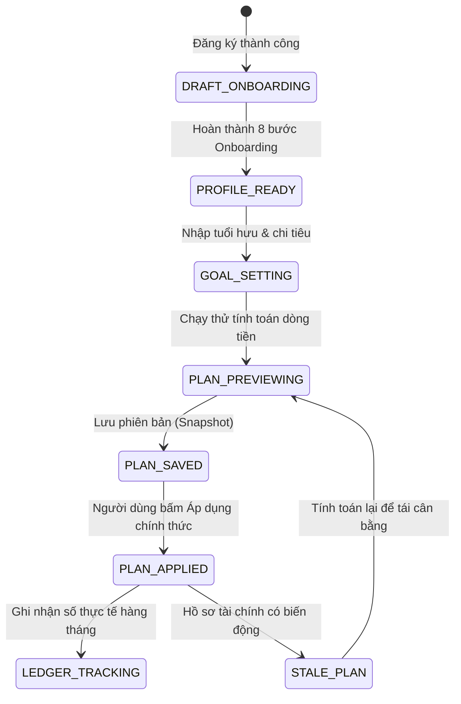
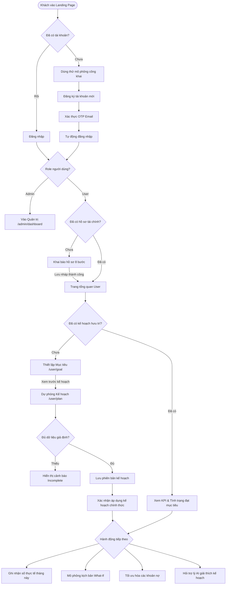

# USER BUSINESS FLOW — BẢN THIẾT KẾ & ĐẶC TẢ NGHIỆP VỤ HÀNH TRÌNH NGƯỜI DÙNG AN HƯU

> **Tài liệu đặc tả nghiệp vụ (Business Requirements & Flow Specification)**  
> **Tác giả:** Senior Business Analyst (10+ năm kinh nghiệm Web App & Fintech SaaS)  
> **Phiên bản:** 2.0 — Chuẩn hóa nghiệp vụ, giải quyết điểm nghẽn trải nghiệm người dùng  
> **Phạm vi đối tượng:** Toàn bộ người dùng phân hệ **USER** (Khách vãng lai, Người dùng mới, Người dùng quay lại)  
> **Tương thích:** React 19, React Router 7, Hệ màu nhận diện *Oceanic Navy & Nordic Ice System*

---

## 1. Tổng quan hệ thống

**An Hưu** là nền tảng số hóa toàn diện về **Hoạch định Tài chính Hưu trí (Retirement Planning SaaS)** dành cho người Việt Nam. Khác với các ứng dụng giao dịch chứng khoán (trading app) tạo áp lực hay gây tâm lý FOMO, An Hưu mang tinh thần **Bình tĩnh (Calm), Minh bạch (Transparent) và Dài hạn (Long-term)**.

### Bản chất nghiệp vụ cốt lõi:
Hệ thống kết nối các dữ kiện đời thực của người dùng để trả lời 4 câu hỏi lớn:
1. **Tôi cần bao nhiêu tiền để nghỉ hưu an yên theo mức sống mong muốn?**
2. **Với tài sản, thu nhập, chi tiêu và nợ hiện tại, tôi đang đạt bao nhiêu % mục tiêu?**
3. **Mỗi tháng tôi cần tích lũy và phân bổ tài sản như thế nào để bù đắp khoản thiếu hụt (nếu có)?**
4. **Kế hoạch của tôi phản ứng ra sao trước biến động thị trường (lạm phát, lợi nhuận biến động) và số liệu thực tế qua từng tháng?**

Hệ thống vận hành trên kiến trúc xác thực tập trung (`AuthContext`), hồ sơ tài chính 2 cấp độ (`FinancialProfileContext` gồm hồ sơ cơ bản v1 và cấu trúc dòng tiền chi tiết v2), cùng công cụ tính toán kế hoạch hưu trí độc lập (`RetirementPlanContext`).

---

## 2. USER Goal (Mục tiêu của người dùng)

### 2.1. Primary Goal (Mục tiêu tối thượng)
- **Hiểu rõ bức tranh tài chính hưu trí cá nhân:** Biết chính xác số tiền cần chuẩn bị ở tuổi nghỉ hưu mong muốn và tỷ lệ hoàn thành hiện tại.
- **Xây dựng được một kế hoạch hành động khả thi:** Thiết lập được lộ trình đóng góp/tích lũy hàng tháng có cơ sở toán học, đã tính đến lạm phát, lương hưu BHXH và chi phí sinh hoạt.
- **Lưu trữ và áp dụng kế hoạch chính thức trên hệ thống:** Có một bản kế hoạch chính thức (`Applied Plan Version`) được lưu bền vững trên máy chủ để theo dõi tiến độ dài hạn.

### 2.2. Secondary Goals (Các mục tiêu hỗ trợ)
- **Cập nhật và hoàn thiện hồ sơ tài sản/nợ:** Khai báo và điều chỉnh tài sản (tiết kiệm, bất động sản, cổ phiếu/quỹ) và các khoản nợ vay (mua nhà, tiêu dùng, thẻ tín dụng).
- **Mô phỏng kịch bản What-If:** Thử nghiệm thay đổi tuổi nghỉ hưu, mức chi tiêu mong muốn hoặc biến động thị trường để xem tác động đến số năm an toàn tài chính.
- **Cá nhân hóa khẩu vị rủi ro:** Trả lời khảo sát rủi ro để chọn danh mục đầu tư tham chiếu phù hợp với độ tuổi và năng lực chịu lỗ.
- **Ghi nhận số liệu thực tế (Actuals Ledger):** Định kỳ ghi nhận dòng tiền thu/chi thực tế hàng tháng để so sánh với kế hoạch lý thuyết và dự phóng lại (Reforecast).
- **Hỏi đáp giải thích bằng Trợ lý AI:** Nhận giải thích dễ hiểu về các chỉ số tài chính, thuật ngữ hưu trí và khuyến nghị điều chỉnh.
- **Khám phá giải pháp & kiến thức:** Tra cứu cẩm nang hưu trí, kiến thức BHXH và danh mục giải pháp tài chính liên kết minh bạch.

---

## 3. Danh sách màn hình hiện tại (Route Inventory)

| Route | Màn hình | Mục đích nghiệp vụ | Entry Point chính | Hành động chính của USER | Next Step tiếp theo | Vấn đề luồng hiện tại |
|---|---|---|---|---|---|---|
| `/` | Landing Page | Giới thiệu giá trị, tạo niềm tin, kêu gọi bắt đầu | Trình duyệt trực tiếp | Bấm CTA "Bắt đầu lập kế hoạch" hoặc "Thử mô phỏng" | `/mo-phong` hoặc `/register` | Chưa có tính năng lưu nháp nhanh cho khách vãng lai |
| `/mo-phong` | Public Simulation | Trải nghiệm thử bài toán hưu trí không cần tài khoản | Menu / Landing CTA | Kéo slider tuổi, chi tiêu, xem số tiền cần tích lũy | `/register` | Kết quả thử tính chưa được mang sang sau khi đăng ký |
| `/login` | Đăng nhập | Xác thực danh tính người dùng | Header / Route Guard | Nhập email/password hoặc đăng nhập Google | `/user/dashboard` | **F01 (High):** Bỏ qua tham số `from`, mất query và hash |
| `/register` | Đăng ký | Mở tài khoản cá nhân mới | Landing / Login | Nhập email, họ tên, mật khẩu | `/verify` | Chưa lưu giữ đích đến ban đầu |
| `/verify` | Xác thực OTP | Kích hoạt bảo mật tài khoản | Sau đăng ký | Nhập mã OTP gồm 6 chữ số gửi qua email | `/login` hoặc `/onboarding` | Bắt đăng nhập lại sau verify thay vì tự động đăng nhập |
| `/onboarding` | Khai báo hồ sơ 8 bước | Thu thập dữ liệu tài chính ban đầu (thu nhập, chi tiêu, tài sản, nợ) | Sau đăng nhập lần đầu / FinancialProfileGate | Điền form từng bước và bấm "Tiếp tục" | `/user/dashboard` | **F02 (High):** Đổi bước trước khi PUT thành công; lỗi mạng gây mất bước |
| `/user/dashboard` | Tổng quan tài chính | Trực quan hóa tài sản ròng, trạng thái kế hoạch và bước tiếp theo | Sau đăng nhập / Sidebar | Đọc chỉ số KPI, bấm tiếp tục công việc dở dang | `/user/goal` hoặc `/user/plan` | **F06 (High):** Lỗi tải kế hoạch bị biến thành "Chưa có kế hoạch" |
| `/user/goal` | Thiết lập mục tiêu | Định nghĩa tuổi nghỉ hưu, mức sống, tuổi thọ kỳ vọng | Dashboard CTA / Sidebar | Điều chỉnh slider tuổi hưu, chi tiêu mong muốn | `/user/plan` | **F03 (Critical):** Báo "Đã lưu" giả dù chỉ lưu local state; PATCH v2 chỉ lưu tháng |
| `/user/plan` | Lập kế hoạch hưu trí | Dự phóng dòng tiền theo tháng, đánh giá độ phủ quỹ | Từ Goal / Sidebar | Xem biểu đồ dự phóng, bấm "Lưu phiên bản" & "Áp dụng" | `/user/simulation` | **F04 (Critical):** Cắt thời hạn dự phóng theo horizon policy khảo sát |
| `/user/simulation` | Mô phỏng What-If & Sổ cái thực tế | So sánh kịch bản thị trường và ghi nhận thu/chi thực tế | Từ Plan / Sidebar | Đổi kịch bản (Base/Adverse), nhập số thực tế hàng tháng | `/user/dashboard` | **F05 (High):** Chưa tính toán vẫn hiện "Đạt mục tiêu", có nguy cơ áp dụng kết quả cũ |
| `/user/debts` | Quản lý & Phân tích nợ | Tối ưu hóa lộ trình trả nợ, giải phóng dòng tiền tích lũy | Sidebar / Onboarding | Thêm khoản vay, thử nghiệm chiến lược trả nợ sớm | `/user/plan` | Thiếu liên kết ngược sang kế hoạch hưu trí khi nợ giảm |
| `/user/risk-portfolio`| Khảo sát khẩu vị rủi ro | Xác định danh mục đầu tư phù hợp (thận trọng / cân bằng / tăng trưởng) | Từ Plan CTA / Sidebar | Trả lời trắc nghiệm trắc lượng tài chính | `/user/plan` | **F08 (High):** Key localStorage dùng chung, nguy cơ ghi đè giữa các tài khoản |
| `/user/assistant` | Trợ lý AI An Hưu | Giải thích báo cáo, tư vấn tháo gỡ điểm nghẽn | Topbar / Sidebar | Hỏi câu hỏi tài chính, yêu cầu giải thích kế hoạch | Tiếp tục điều chỉnh plan | **F12 (Medium):** Thiếu plan thì nút gửi bị disable mà không hướng dẫn tạo plan |
| `/user/explore` | Khám phá & Cẩm nang | Đọc bài viết, xem sản phẩm liên kết minh bạch | Sidebar | Đọc kiến thức, lọc danh mục giải pháp | Xem chi tiết sản phẩm | **F07 (High):** Trộn lẫn 3 sản phẩm mock data vào API thật |
| `/user/account` | Hồ sơ & Cài đặt | Quản lý bảo mật, thông báo và xuất báo cáo | Topbar Avatar / Drawer | Cập nhật thông tin cá nhân, tải CSV kế hoạch | Tiếp tục sử dụng app | **F11 (High):** Settings lỗi vẫn cho đổi local; CSV fallback khác công thức máy chủ |
| `/user/support` | Hỗ trợ khách hàng | Gửi yêu cầu trợ giúp và theo dõi ticket | Topbar / Drawer | Tạo yêu cầu hỗ trợ mới, phản hồi tư vấn viên | Đóng ticket | Chưa có thông báo khi có phản hồi mới từ admin |
| `/user/notifications`| Trung tâm thông báo | Nhận cảnh báo thay đổi hồ sơ, nhắc định giá định kỳ | Topbar Chuông | Xem danh sách thông báo, đánh dấu đã đọc | Điều hướng theo context | Thiếu nút "Đánh dấu tất cả đã đọc" |

---

## 4. AS-IS Flow (Phân tích luồng thực tế hiện tại & Điểm nghẽn)

```
[Khách truy cập] 
       │
       ▼
[Landing / Mô phỏng công khai]
       │ (Bấm Bắt đầu)
       ▼
[Đăng ký tài khoản] ──(OTP)──> [Xác thực Email] ──> [Đăng nhập]
                                                        │ (Bỏ qua 'from' URL!)
                                                        ▼
                                              [Kiểm tra hồ sơ Gate]
                                                 │             │
                                          (Chưa có)         (Đã có)
                                                 │             │
                                                 ▼             ▼
                                        [Onboarding 8 bước]  [Dashboard]
                                                 │             │
                                                 ▼             ▼
                                             [Dashboard] ──> [Goal]
                                                               │ (Báo "Đã lưu" giả!)
                                                               ▼
                                                            [Plan]
                                                               │ (Bị cắt ngắn năm dự phóng!)
                                                               ▼
                                                         [Simulation]
                                                               │ (Chưa tính vẫn báo Đạt!)
                                                               ▼
                                                         [Bế tắc luồng]
```

### Các điểm gãy luồng (Friction Points) nghiêm trọng:
1. **Mất dấu ngữ cảnh sau đăng nhập:** Người dùng nhấn link hỗ trợ `/user/support?ticket=123`, hệ thống bắt đăng nhập, nhưng sau đăng nhập lại ép về `/user/dashboard`.
2. **Onboarding thiếu độ bền dữ liệu:** Bấm "Tiếp tục" thì UI chuyển sang bước tiếp theo ngay lập tức. Nếu mạng lỗi, API `PUT` thất bại ngầm trong background mà người dùng không biết, dẫn đến mất dữ liệu khi reload.
3. **Mục tiêu hưu trí (Goal) gây hiểu nhầm:** Người dùng chỉnh tuổi hưu và chi tiêu, bấm "Lưu thay đổi", nhận thông báo "Đã lưu hồ sơ thành công". Nhưng khi reload trang hoặc mở thiết bị khác, dữ liệu quay về như cũ vì backend chưa có API lưu độc lập cho Goal nháp.
4. **Kế hoạch (Plan) kết luận an toàn giả tạo:** Người dùng muốn dự phóng đến năm 85 tuổi (30 năm nghỉ hưu), nhưng danh mục khảo sát chỉ có dữ liệu 10 năm (120 tháng). Hệ thống âm thầm cắt thời gian tính toán xuống 10 năm và tuyên bố quỹ tài chính an toàn 100%.
5. **Mô phỏng (Simulation) có kết quả rác:** Khi dữ liệu chưa sẵn sàng hoặc API đang tính toán, giao diện vẫn hiển thị số liệu 0 ₫ kèm huy hiệu "Đạt mục tiêu" màu xanh lá, cho phép người dùng bấm "Áp dụng" một kết quả rỗng.

---

## 5. Bảng tổng hợp các vấn đề nghiệp vụ hiện tại

| ID | Mức độ | Màn hình | Mô tả chi tiết vấn đề | Nguyên nhân kỹ thuật / nghiệp vụ | Ảnh hưởng đến người dùng | Giải pháp khắc phục triệt để |
|---|---|---|---|---|---|---|
| **F01** | **High** | Auth / Login | Mất đích đến ban đầu sau khi đăng nhập thành công. | Guard lưu `from` vào state nhưng `LoginPage` không đọc state để redirect; query params và hash bị rơi rụng. | Người dùng bấm link thông báo, ticket hỗ trợ hoặc chia sẻ bị chuyển về Dashboard, phải tự tìm lại trang. | Lưu đầy đủ `location.pathname + location.search + location.hash` và điều hướng chính xác sau login. |
| **F02** | **High** | Onboarding | Chuyển bước trước khi API xác nhận lưu thành công. | Code gọi `saveOnboardingDraft()` bất đồng bộ nhưng `setCurrentStep()` chạy ngay lập tức. | Nếu mạng yếu hoặc server lỗi, người dùng tưởng đã lưu xong; khi refresh bị mất trắng các bước vừa điền. | Chờ `saveOnboardingDraft()` giải quyết thành công (`await`) mới chuyển bước; hiển thị inline error và nút thử lại nếu lỗi. |
| **F03** | **Critical** | Goal | Thông báo lưu thành công giả tạo, gây mất dữ liệu. | `RetirementGoalPage` cập nhật local state và PATCH v2 nhưng v2 chỉ nhận tháng nghỉ hưu, không lưu chi tiêu/tuổi thọ. | Người dùng tưởng đã thiết lập xong mục tiêu hưu trí, nhưng reload là mất sạch thông số đã chỉnh. | Đổi Primary CTA thành "Xem trước kế hoạch" (`/user/plan`); Secondary CTA thành "Lưu nháp trên máy này" với tooltip giải thích minh bạch. |
| **F04** | **Critical** | Plan | Cắt ngắn thời gian nghỉ hưu theo thời hạn của policy khảo sát. | Code gán `projectHorizonMonths = policy.horizonMonths` (thường là 120 tháng = 10 năm) thay vì tính đủ đến tuổi thọ kỳ vọng (80–85 tuổi). | Người dùng sống đến 85 tuổi nhưng hệ thống chỉ tính đến 70 tuổi và kết luận "Đủ quỹ hưu trí", tạo sự an tâm giả rất nguy hiểm. | Giữ nguyên thời hạn dự phóng theo tuổi thọ; nếu policy thiếu dữ liệu, hiển thị trạng thái `INCOMPLETE` và yêu cầu bổ sung giả định. |
| **F05** | **High** | Simulation | Hiển thị đạt mục tiêu và cho phép áp dụng kết quả rỗng/chưa tính. | Thiếu điều kiện kiểm tra dữ liệu: khi `calculation` undefined, mặc định fallback về 0 và gán badge thành công. | Người dùng vô tình ghi đè kế hoạch chính thức bằng một phiên bản mô phỏng rác không có số liệu. | Vô hiệu hóa nút "Áp dụng" khi trạng thái không phải `READY`; hiển thị Skeleton / Loading state rõ ràng khi đang tính toán. |
| **F06** | **High** | Dashboard | Đánh đồng lỗi kết nối mạng với trạng thái chưa có kế hoạch. | Khi API `getPlanReport()` trả về lỗi, catch block set state về `null` giống hệt trường hợp tài khoản mới chưa tạo plan. | Người dùng tưởng bị mất kế hoạch, hoang mang bấm tạo kế hoạch mới gây trùng lặp phiên bản. | Tách biệt 3 trạng thái: `Loading`, `Network/API Error` (có nút bấm Thử lại) và `Empty Plan` (hướng dẫn tạo mới). |
| **F07** | **High** | Explore | Trộn sản phẩm tài chính giả lập vào danh mục đối tác chính thức. | Màn hình Explore lấy catalog từ API nhưng lại tự động append thêm 3 sản phẩm hardcoded trong localStorage. | Người dùng không phân biệt được đâu là sản phẩm thật của đối tác, đâu là dữ liệu mẫu demo. | Chỉ hiển thị dữ liệu trả về từ API catalog; nếu API rỗng, hiển thị Empty State chuẩn mực và giải thích minh bạch. |
| **F08** | **High** | Risk Portfolio | Câu trả lời khảo sát rủi ro lưu chung một key localStorage cho mọi tài khoản. | Code dùng key cứng `anhuu_risk_survey_answers` không gắn với User ID. | Người dùng B đăng nhập trên cùng máy tính sẽ nhìn thấy và dùng nhầm khẩu vị rủi ro của người dùng A. | Đổi key lưu trữ thành `anhuu_risk_survey_${user.id}_${policy.id}`; xóa sạch state khảo sát khi đăng xuất. |
| **F09** | **Medium** | Mobile Shell | Menu Drawer trên thiết bị di động thiếu mục Khảo sát rủi ro. | Mảng `drawerNavItems` trong `UserLayout.tsx` thiếu route `/user/risk-portfolio`. | Người dùng điện thoại không thể tìm thấy trang khảo sát rủi ro nếu không bấm link ngầm từ trang Plan. | Hợp nhất một danh sách điều hướng chuẩn mực áp dụng chung cho cả Desktop Sidebar và Mobile Drawer. |
| **F10** | **High** | Admin Settings | Cài đặt hệ thống chỉ lưu trên trình duyệt của Admin nhưng thông báo như đã áp dụng máy chủ. | Code Admin Settings lưu vào `localStorage` cá nhân. | Admin tưởng hệ thống đã bật bảo vệ/tích hợp, nhưng thực tế toàn bộ người dùng khác không chịu tác động. | Đổi nhãn thành "Cấu hình giả lập trên trình duyệt" hoặc kết nối API cấu hình máy chủ thực tế. |
| **F11** | **High** | Account | Cho phép đổi cài đặt khi API tải lỗi; xuất CSV không đồng nhất engine. | Form cài đặt notification không disable khi GET thất bại; logic xuất CSV dùng hàm nội suy thay vì snapshot máy chủ. | Cài đặt không được ghi nhận bền vững; file CSV báo cáo không khớp số liệu với giao diện kế hoạch. | Chỉ cho lưu khi có `revision`; xuất CSV trực tiếp từ API phiên bản máy chủ `exportPlanVersionCsv`. |
| **F12** | **Medium** | Assistant | Thiếu kế hoạch thì vô hiệu hóa nút gửi tin nhắn mà không hướng dẫn. | Nút gửi bị disabled khi chưa có `activePlan` nhưng không có thông báo hay CTA chỉ dẫn. | Người dùng mới không hiểu tại sao AI không trả lời, tưởng hệ thống bị đơ. | Hiển thị banner hướng dẫn: *"Trợ lý AI cần dữ liệu kế hoạch để phân tích. Hãy tạo kế hoạch trước"* kèm nút bấm đến `/user/goal`. |

---

## 6. Phân loại trạng thái người dùng (USER States)

Một hệ thống chuẩn mực phải thích ứng linh hoạt theo trạng thái thực tế của người dùng:

1. **State 1: Visitor (Khách vãng lai chưa đăng nhập)**  
   - Được xem Landing Page, bài viết kiến thức công khai, và dùng thử công cụ tính toán nhanh tại `/mo-phong`.  
   - Không được truy cập các route nội bộ `/user/*`.
2. **State 2: Registered Unverified (Đã đăng ký, chờ xác thực OTP)**  
   - Tài khoản đã tạo nhưng chưa kích hoạt email. Hệ thống giữ ở `/verify`, cho phép gửi lại mã OTP.
3. **State 3: Authenticated No Profile (Đã đăng nhập, chưa có hồ sơ tài chính)**  
   - Bị chặn bởi `FinancialProfileGate`. Luồng duy nhất được phép là `/onboarding` để hoàn thành hồ sơ 8 bước.
4. **State 4: Onboarding In-Progress (Đang làm dở hồ sơ)**  
   - Có bản nháp `onboardingDraft` lưu trên máy chủ. Khi vào lại, hệ thống mở đúng bước đang dừng lại.
5. **State 5: Profile Complete No Plan (Đã có hồ sơ, chưa có kế hoạch hưu trí)**  
   - Đã qua Onboarding. Dashboard hiển thị Empty State kế hoạch, làm nổi bật Primary CTA: **"Bắt đầu thiết lập mục tiêu hưu trí"** dẫn sang `/user/goal`.
6. **State 6: Plan In-Draft (Đang thử nghiệm mục tiêu & xem trước kế hoạch)**  
   - Người dùng đang thay đổi thông số trên màn hình Goal hoặc đang chạy preview trên màn hình Plan. Kế hoạch này là bản tính thử (`Preview/Draft`), chưa phải kế hoạch chính thức.
7. **State 7: Official Plan Applied (Đã lưu & áp dụng kế hoạch chính thức)**  
   - Kế hoạch đã được xác nhận áp dụng (`currentVersion` tồn tại trên backend). Dashboard hiển thị đầy đủ KPI, độ phủ quỹ và phân bổ tài sản.
8. **State 8: Stale Plan (Kế hoạch cần cập nhật lại do thay đổi hồ sơ)**  
   - Người dùng vừa sửa thu nhập hoặc thêm khoản nợ mới trong hồ sơ tài chính, khiến kế hoạch cũ không còn phản ánh đúng thực tế. Hệ thống hiển thị cảnh báo: *"Hồ sơ tài chính vừa thay đổi. Hãy tính toán lại kế hoạch để đồng bộ"*.
9. **State 9: Ledger Active (Người dùng định kỳ ghi nhận số thực tế)**  
   - Người dùng đã nhập dữ liệu thực tế tại `/user/simulation?tab=actuals`. Hệ thống hiển thị đường so sánh giữa Kế hoạch lý thuyết và Thực tế tích lũy.

---

## 7. Happy Path (Con đường lý tưởng ngắn nhất)

```
[1. Khách xem Landing / Mô phỏng]
                 │
                 ▼
[2. Đăng ký & Xác thực OTP nhanh]
                 │
                 ▼
[3. Hoàn tất Onboarding 8 bước] ──(Lưu nháp bền vững từng bước)
                 │
                 ▼
[4. Khám phá Dashboard tổng quan] ──(Thấy tài sản ròng & CTA tạo mục tiêu)
                 │
                 ▼
[5. Thiết lập Mục tiêu hưu trí] ──(Chọn tuổi nghỉ hưu & mức sống mong muốn)
                 │
                 ▼
[6. Xem trước Kế hoạch chi tiết] ──(Dự phóng dòng tiền đầy đủ đến tuổi thọ)
                 │
                 ▼
[7. Lưu phiên bản & Xác nhận áp dụng] ──(Trở thành Kế hoạch chính thức)
                 │
                 ▼
[8. Theo dõi định kỳ & Hỏi đáp AI] ──(Ghi nhận thu chi thực tế hàng tháng)
```

---

## 8. New User Flow (Luồng người dùng mới)

### CASE 01: Lần đầu truy cập website
- **Người dùng thấy gì:** Tiêu đề rõ ràng: *"Kế hoạch hưu trí cho người Việt — An tâm hôm nay, an yên ngày mai"*. Không đòi hỏi đăng nhập ngay.
- **CTA chính:** Nút màu Royal Blue: **"Bắt đầu lập kế hoạch"** (dẫn đến `/register`) và nút phụ viền mềm: **"Khám phá mô phỏng"** (dẫn đến `/mo-phong`).
- **Trải nghiệm mô phỏng công khai:** Người dùng kéo tuổi hiện tại (ví dụ: 30) và tuổi nghỉ hưu (ví dụ: 60), thấy ngay số tiền dự kiến cần tích lũy. Dưới kết quả có banner: *"Lưu lại kết quả này để xây dựng lộ trình chi tiết"* kèm nút đăng ký.

### CASE 02: Chưa có tài khoản & Đăng ký
- Màn hình `/register` thu thập tối giản: Họ tên, Email, Mật khẩu. Hỗ trợ đăng ký nhanh bằng Google.
- Đăng ký xong chuyển sang `/verify`. Sau khi nhập đúng 6 số OTP, hệ thống **tự động đăng nhập người dùng vào phiên làm việc** và chuyển thẳng đến `/onboarding`, không bắt người dùng gõ lại mật khẩu tại trang `/login`.

### CASE 04: Đăng nhập lần đầu (Welcome Onboarding)
- Người dùng được chào đón bằng màn hình Onboarding bước 0 (Khởi đầu): *"Hãy dành 3 phút chia sẻ tình hình tài chính hiện tại để An Hưu đồng hành cùng bạn"*.
- Tiến trình 8 bước trực quan: Cá nhân → Thu nhập → Chi tiêu → Tài sản → Nợ vay → Đầu tư & BHXH → Tổng kết tài sản ròng.
- **Cam kết kỹ thuật:** Mỗi khi người dùng bấm "Tiếp tục", hệ thống gửi API lưu nháp. Nếu lưu thành công mới cuộn mượt sang bước kế tiếp. Nếu mất mạng, form giữ nguyên dữ liệu và hiển thị nút **"Thử lại"**.

### CASE 05: Đăng nhập nhưng chưa có kế hoạch (Empty Dashboard State)
- Sau khi hoàn thành Onboarding, người dùng vào `/user/dashboard`.
- Thay vì để một vùng biểu đồ trống trơn hay số liệu 0 ₫ vô nghĩa, Dashboard hiển thị **Khung chào đón định hướng**:
  - Thẻ 1: Tóm tắt tài sản ròng vừa khai báo (ví dụ: Thu nhập 25 tr, Chi tiêu 15 tr, Thặng dư 10 tr/tháng).
  - Thẻ 2: Banner hướng dẫn hành động tiếp theo: *"Bước tiếp theo: Thiết lập mục tiêu hưu trí đầu tiên của bạn"*.
  - **CTA duy nhất nổi bật:** **"Thiết lập mục tiêu ngay"** (màu Royal Blue) dẫn thẳng sang `/user/goal`.

---

## 9. Returning User Flow (Luồng người dùng quay lại)

### CASE 06: Đã có kế hoạch chính thức
- Người dùng đăng nhập trở lại, Dashboard lập tức phản ánh tình trạng sức khỏe tài chính hưu trí:
  - **Chỉ số trọng tâm:** Tỷ lệ đạt mục tiêu (ví dụ: `72%`), Số tiền dự kiến khi nghỉ hưu, Khoản thiếu hụt dự kiến.
  - **Hành động được gợi ý:** *"Cập nhật số liệu thực tế tháng này"* (dẫn sang sổ cái) hoặc *"Khám phá cách tối ưu danh mục đầu tư"*.
- Không bao giờ hiển thị lại các màn hình onboarding hay banner chào mừng sơ cấp.

### CASE 07: Tiếp tục phiên làm việc dở dang
- Nếu lần trước người dùng đang làm dở Onboarding ở bước 4 (Tài sản) rồi tắt trình duyệt: Khi đăng nhập lại, hệ thống nhận diện `onboardingDraft.step = 'assets'` và tự động mở lại chính xác bước 4 kèm toàn bộ số liệu đã điền trước đó.

### CASE 08: Thoát giữa chừng khi đang chỉnh sửa Kế hoạch
- Nếu người dùng đang thử nghiệm các slider trên màn hình Goal hoặc Plan nhưng chưa bấm lưu: Hệ thống lưu các tham số này vào phiên làm việc trình duyệt (`sessionDraft`). Khi vào lại, hiển thị thanh thông báo nhỏ: *"Bạn có một phiên thử nghiệm chưa lưu. Bạn có muốn khôi phục không?"* kèm nút "Khôi phục" và "Bỏ qua".

---

## 10. Authentication Flow & Bảo toàn ngữ cảnh (Auth Redirect Flow)

```
[Người dùng chưa login bấm link: /user/support?ticket=123]
                            │
                            ▼
           [RequireRole Guard phát hiện chưa login]
                            │
                            ▼
        [Chuyển hướng đến /login kèm location.state]
        state = { from: '/user/support?ticket=123' }
                            │
                            ▼
                 [Người dùng nhập mật khẩu]
                            │
                            ▼
               [API Xác thực trả về 200 OK]
                            │
                            ▼
             [Kiểm tra đích đến hợp lệ theo Role]
         /user/support?ticket=123 là route user hợp lệ?
                 │                         │
               (Có)                      (Không)
                 │                         │
                 ▼                         ▼
   [Navigate về đúng URL gốc!]   [Fallback về /user/dashboard]
```

### Quy tắc an toàn chống Open Redirect:
- Đích đến chỉ được chấp nhận nếu bắt đầu bằng đường dẫn tương đối nội bộ (ví dụ: `/user/`, `/admin/`).
- Tuyệt đối loại bỏ các URL chứa giao thức bên ngoài (`https://malicious.com`), protocol-relative (`//evil.com`) hoặc chứa ký tự escape (`\`).

---

## 11. Main Business Flow (Luồng nghiệp vụ chuyên sâu)

```
┌────────────────────────┐
│  HỒ SƠ TÀI CHÍNH (V2)  │ ◄── Thu nhập, Chi tiêu, Tài sản tích lũy, Lương BHXH, Khoản nợ
└───────────┬────────────┘
            │
            ▼
┌────────────────────────┐
│   MỤC TIÊU HƯU TRÍ     │ ◄── Tuổi nghỉ hưu (vd: 60), Tuổi thọ (vd: 85), Mức sống mong muốn
└───────────┬────────────┘
            │ (Bấm "Xem trước kế hoạch")
            ▼
┌────────────────────────┐
│  DỰ PHÓNG KẾ HOẠCH     │ ◄── Ghép chuỗi giả định thị trường đủ 25 năm nghỉ hưu
└───────────┬────────────┘
            │
      (Đủ dữ liệu?)
       ├── CÓ ──> [Lưu phiên bản kế hoạch (Snapshot)] ──> [Xác nhận Áp dụng chính thức]
       └── THIẾU ─> [Báo trạng thái INCOMPLETE] ──> [Hướng dẫn chọn kịch bản cơ sở]
```

### Ba nguyên tắc nghiệp vụ cốt lõi:
1. **Goal không tự ý sửa Profile:** Việc người dùng điều chỉnh "Chi tiêu giả định ở tuổi hưu" trên màn hình Goal phục vụ cho việc tính toán nhu cầu tương lai, tuyệt đối không được ghi đè làm thay đổi "Chi tiêu sinh hoạt hàng tháng hiện tại" trong Hồ sơ tài chính.
2. **Kế hoạch chính thức cần sự xác nhận chủ động:** Việc tính toán thử nghiệm (Preview) hoặc lưu nháp một phiên bản (Save Version) không tự động biến nó thành kế hoạch chính thức. Người dùng phải trải qua bước bấm **"Áp dụng kế hoạch này"** kèm hộp thoại xác nhận.
3. **Tính nhất quán của tuổi và tháng sinh:** Khi người dùng thay đổi tuổi nghỉ hưu, hệ thống tính toán mốc thời gian dựa trên tháng/năm sinh đã khai báo trong hồ sơ cá nhân. Không tự động gán tháng sinh về tháng 12 gây sai lệch mốc bắt đầu nhận lương hưu.

---

## 12. Empty State Flow (Xử lý trạng thái rỗng)

Mọi màn hình khi chưa có dữ liệu đều phải tuân thủ công thức: **Giải thích lý do + Minh họa trực quan nhẹ + 1 CTA hành động rõ ràng**:

1. **Dashboard chưa có Plan:**  
   - *Thông điệp:* "Bạn chưa có kế hoạch hưu trí chính thức nào được áp dụng."  
   - *CTA chính:* "Bắt đầu thiết lập mục tiêu hưu trí" → `/user/goal`.
2. **Sổ cái thực tế chưa có giao dịch (Simulation Actuals):**  
   - *Thông điệp:* "Chưa có tháng nào được ghi nhận dòng tiền thực tế."  
   - *CTA chính:* "Ghi nhận tháng đầu tiên" → Mở modal nhập thu/chi tháng hiện tại.
3. **Chưa có khoản nợ nào (Debt Analysis):**  
   - *Thông điệp:* "Tuyệt vời! Bạn không có khoản nợ nào được ghi nhận. Toàn bộ thặng dư có thể dành cho tích lũy."  
   - *CTA phụ:* "Thêm khoản nợ nếu có" → Mở form khai báo nợ.
4. **Hộp thư thông báo rỗng:**  
   - *Thông điệp:* "Bạn đã xem hết các thông báo. Mọi cập nhật về kế hoạch sẽ xuất hiện tại đây."  
   - *CTA:* "Về trang tổng quan" → `/user/dashboard`.
5. **Chưa có yêu cầu hỗ trợ (Support Page):**  
   - *Thông điệp:* "Bạn chưa gửi yêu cầu hỗ trợ nào."  
   - *CTA chính:* "Gửi yêu cầu trợ giúp đầu tiên" → Mở form gửi ticket.

---

## 13. Error Flow & Cơ chế phục hồi (Error Recovery)

| Tình huống lỗi | Hành vi hệ thống yêu cầu | Thông điệp hiển thị cho người dùng | Hành động khắc phục |
|---|---|---|---|
| **CASE 09: Dữ liệu nhập sai / Không hợp lệ** | Giữ nguyên toàn bộ dữ liệu trên form, không redirect; cuộn và focus vào ô lỗi đầu tiên; viền đỏ ô lỗi. | *"Tuổi nghỉ hưu (55) phải lớn hơn tuổi hiện tại (58)"* | Người dùng sửa lại số năm và bấm tiếp tục bình thường. |
| **CASE 10A: Mất kết nối mạng (Network Error)** | Giữ nguyên dữ liệu trong bộ nhớ tạm; nút bấm đổi sang trạng thái lỗi có icon cảnh báo. | *"Mất kết nối mạng. Dữ liệu của bạn vẫn an toàn trên máy."* | Nút bấm chuyển thành **"Thử lại"**; tự động đồng bộ khi có mạng trở lại. |
| **CASE 10B: Xung đột phiên bản dữ liệu (409 Conflict)** | Hệ thống phát hiện dữ liệu trên máy chủ mới hơn dữ liệu đang sửa ở tab này. | *"Hồ sơ đã được cập nhật từ một tab hoặc thiết bị khác."* | Hiển thị nút **"Tải dữ liệu mới nhất"** để xem thay đổi, không tự ý ghi đè mất công sức của người dùng. |
| **CASE 10C: Hết hạn phiên đăng nhập (401 Unauthorized)** | Lưu toàn bộ state đang làm dở vào localStorage; hiển thị modal thông báo hết phiên thay vì đá văng đột ngột. | *"Phiên làm việc đã hết hạn để đảm bảo an toàn tài chính của bạn."* | Mở popup đăng nhập nhanh tại chỗ; đăng nhập xong tiếp tục thao tác không mất dữ liệu. |
| **CASE 10D: Lỗi máy chủ nội bộ (500 Server Error)** | Không hiển thị màn hình trắng (White Screen of Death); giữ nguyên khung App Shell. | *"Máy chủ đang bận xử lý bài toán dự phóng phức tạp. Vui lòng thử lại sau giây lát."* | Nút **"Tải lại trang"** hoặc liên hệ hỗ trợ. |

---

## 14. Permission Flow (Phân quyền & Ranh giới truy cập)

```
[Truy cập một Route bất kỳ]
            │
            ▼
    [Kiểm tra Authenticated?]
     ├── CHƯA ──> Chuyển về /login kèm lưu 'from'
     └── RỒI
          │
          ▼
    [Kiểm tra User Role]
     ├── User cố tình gõ /admin/*
     │     └──> Bị chặn: Hiển thị thông báo 403 không có quyền + CTA "Về Không gian cá nhân"
     └── Admin mở /user/*
           └──> Cho phép xem với tư cách người dùng hoặc chuyển về /admin/dashboard
```

---

## 15. Các trường hợp biên đặc thù (Edge Cases)

1. **Người dùng nhấn nút Back của trình duyệt khi đang làm Onboarding:**  
   - Hệ thống quay lại bước trước đó mà không làm mất dữ liệu của bước hiện tại.
2. **Người dùng mở 2 tab cùng sửa Hồ sơ tài chính:**  
   - Backend sử dụng cơ chế `expectedRevision`. Tab nào lưu sau khi phiên bản đã cũ sẽ nhận mã lỗi 409 và thông báo tải lại dữ liệu mới.
3. **Người dùng chuyển đổi tài khoản trên cùng một máy tính:**  
   - Hàm `logout()` xóa triệt để: Session Token, Local Drafts, Khảo sát rủi ro cá nhân. Người dùng mới đăng nhập tuyệt đối không thấy tàn dư dữ liệu của người trước.
4. **Không có thặng dư hàng tháng (Thu nhập = Chi tiêu hoặc Âm tiền):**  
   - Hệ thống chấp nhận giá trị `0 ₫`, tuyệt đối không tự động gán số giả (ví dụ: không tự gán 5 triệu/tháng). Giao diện hiển thị cảnh báo nhẹ: *"Hiện bạn không có thặng dư hàng tháng để tích lũy hưu trí. Hãy xem xét phương án tối ưu nợ và chi tiêu"* kèm link đến `/user/debts`.
5. **Chính sách khảo sát rủi ro thay đổi trên hệ thống:**  
   - Nếu quản trị viên cập nhật bộ câu hỏi khảo sát rủi ro mới, các câu trả lời cũ không còn khớp sẽ bị đánh dấu cần cập nhật lại, không gây crash ứng dụng.
6. **Người dùng nhập tuổi nghỉ hưu lớn hơn tuổi thọ kỳ vọng:**  
   - Form validate ngay lập tức: Tuổi thọ kỳ vọng phải lớn hơn tuổi nghỉ hưu ít nhất 5 năm (để có giai đoạn nghỉ hưu có ý nghĩa).

---

## 16. Thiết kế luồng mới hoàn chỉnh (TO-BE User Flow)

### Bảy tiêu chuẩn vàng của TO-BE Flow:
1. **Clarity (Minh bạch):** Người dùng luôn biết mình đang ở đâu qua Breadcrumb, Sidebar active state và Title rõ ràng.
2. **Direction (Có định hướng):** Mỗi trang luôn có **duy nhất 1 Primary CTA** chỉ dẫn bước logic tiếp theo.
3. **Context (Bảo toàn ngữ cảnh):** Không mất dữ liệu khi reload, không đá văng về Dashboard khi login lại.
4. **Minimum Steps (Tối ưu bước):** Verify OTP xong tự động đăng nhập; Lưu kế hoạch xong gợi ý áp dụng ngay.
5. **Consistency (Nhất quán):** Nút chính luôn màu Royal Blue `#334DAF`; số liệu tiền tệ đồng nhất định dạng VND `1.000.000 ₫`.
6. **Error Recovery (Khắc phục lỗi nhân văn):** Báo lỗi đi kèm giải pháp và nút thử lại, không dùng câu chữ kỹ thuật khô khan.
7. **No Dead End (Không đường cùng):** Không có trang nào sau khi hoàn thành mà người dùng không biết phải đi đâu tiếp theo.

---

## 17. Chiến lược Navigation (Điều hướng đa nền tảng)

### Cấu trúc Module chuẩn:
- **Nhóm Nghiệp vụ chính (Core Planning Loop):**
  1. `Tổng quan` (`/user/dashboard`) — Trực quan hóa tình trạng & bước kế tiếp.
  2. `Mục tiêu hưu trí` (`/user/goal`) — Thiết lập kỳ vọng tuổi hưu & mức sống.
  3. `Kế hoạch hưu trí` (`/user/plan`) — Bảng dự phóng dòng tiền & độ phủ quỹ.
  4. `Mô phỏng & Thực tế` (`/user/simulation`) — Thử kịch bản What-If & Sổ cái ghi nhận hàng tháng.
- **Nhóm Công cụ chuyên sâu (Deep Dive Tools):**
  5. `Phân tích nợ` (`/user/debts`) — Tối ưu hóa dòng tiền trả nợ.
  6. `Khảo sát rủi ro` (`/user/risk-portfolio`) — Cá nhân hóa danh mục đầu tư.
  7. `Trợ lý AI` (`/user/assistant`) — Hỏi đáp & phân tích thông minh.
- **Nhóm Hỗ trợ & Khám phá:**
  8. `Khám phá & Cẩm nang` (`/user/explore`) — Kiến thức & giải pháp liên kết.
  9. `Hồ sơ tài chính` (`/user/account`) — Quản lý thông tin & xuất báo cáo.
  10. `Hỗ trợ khách hàng` (`/user/support`) — Kênh phản hồi trực tiếp.

---

## 18. Chiến lược nút kêu gọi hành động (CTA Strategy)

Mỗi viewport chỉ có **một Primary CTA nổi bật nhất**:
- **Landing Page:** `Bắt đầu lập kế hoạch` (Royal Blue `#334DAF`, chữ trắng).
- **Onboarding:** `Tiếp tục` (Primary), `Quay lại` (Ghost), `Lưu nháp & Thoát` (Link).
- **Dashboard (Chưa plan):** `Thiết lập mục tiêu hưu trí` (Primary CTA lớn).
- **Goal Page:** `Xem trước kế hoạch` (Primary CTA), `Lưu nháp trên máy này` (Secondary).
- **Plan Page:** `Áp dụng kế hoạch chính thức` (Primary CTA có xác nhận), `Lưu phiên bản nháp` (Secondary).
- **Simulation Page:** `Chạy thử kịch bản` (Primary), `Áp dụng vào kế hoạch chính thức` (Chỉ enable khi READY).

---

## 19. Chiến lược Dashboard thông minh

Dashboard An Hưu được thiết kế để trả lời 4 câu hỏi trong vòng 5 giây:
1. **Tôi đang ở trạng thái nào?** → Hiển thị Badge tiến độ hồ sơ (`100%`) và Tình trạng kế hoạch (`Đã áp dụng` hoặc `Cần tạo kế hoạch`).
2. **Tôi có dữ liệu gì?** → Hiển thị Thẻ Tài sản ròng (Net Worth Donut Chart) gồm 4 thành phần: Tiết kiệm, Bất động sản, Cổ phiếu/Quỹ, Tài sản khác.
3. **Khoảng cách mục tiêu là bao nhiêu?** → Thẻ KPI hưu trí: Số tiền dự kiến ở tuổi 60, Số tiền cần có, Tỷ lệ đáp ứng (`%`).
4. **Tôi cần làm gì tiếp theo?** → Thẻ Hành động nổi bật (Actionable Next Step Banner) dẫn thẳng đến nhiệm vụ quan trọng nhất.

---

## 20. Biểu đồ chuyển đổi trạng thái nghiệp vụ (State Transitions)



---

## 21. Đánh giá tác động Backend (Backend Impact Analysis)

| Hạng mục cải tiến | Phạm vi tác động | Chi tiết yêu cầu kỹ thuật |
|---|---|---|
| **F01: Auth Redirect preservation** | **Frontend Only** | Cập nhật router state trong `App.tsx` và `AuthPages.tsx`. Tận dụng URL API hiện có. |
| **F02: Onboarding step durability** | **Frontend Only** | Đổi thứ tự thực thi: `await saveOnboardingDraft()` trước khi gọi `setCurrentStep()`. |
| **F03: Goal vs Plan separation** | **Frontend Only** | Sửa ý nghĩa CTA, chuyển hướng đúng sang `/user/plan`. |
| **F04: Horizon validation & incomplete alert** | **Frontend Only** | Kiểm tra độ dài `portfolio.horizonMonths` so với số tháng cần tính; hiển thị warning. |
| **F05: Simulation apply guard** | **Frontend Only** | Thêm điều kiện khóa nút: `disabled={!calculation || calculation.summary.coveragePercent === '0'}`. |
| **F06: Dashboard error isolation** | **Frontend Only** | Tách biến state `planError` riêng biệt với `activePlan === null`. |
| **F07: Explore catalog mock removal** | **Frontend Only** | Xóa logic merge mảng localStorage giả trong `ExplorePage.tsx`. |
| **F08: Risk survey per-user key** | **Frontend Only** | Gắn `user.id` vào key `localStorage.getItem('anhuu_risk_survey_' + user.id)`. |
| **[PROPOSED FEATURE] Lưu Goal nháp độc lập trên máy chủ** | **Frontend + Backend + DB** | Cần tạo bảng `user_goal_drafts` và endpoint `PUT /me/goal-draft`. Hiện tại giải quyết tối ưu bằng Session Storage trên Frontend. |

---

## 22. Screen-by-Screen Recommendations (Đặc tả chi tiết từng màn hình)

### Màn hình 1: ONBOARDING — Khai báo hồ sơ 8 bước
- **Route:** `/onboarding`
- **Mục đích:** Thu thập dữ liệu tài chính ban đầu có cấu trúc.
- **Entry Point:** Tự động sau verify đăng ký, hoặc bấm "Khai báo hồ sơ" từ Dashboard.
- **User State:** Authenticated, chưa có hoặc đang hoàn thiện hồ sơ.
- **Primary CTA:** "Tiếp tục sang bước tiếp theo" (Nút xanh `#334DAF`, chỉ bấm được khi validate form bước hiện tại đạt).
- **Secondary CTA:** "Quay lại bước trước" (Nút ghost).
- **Hành vi khắc phục lỗi:** Chỉ chuyển bước khi API PUT trả về `200 OK`. Nếu lỗi mạng, hiển thị Alert đỏ có nút "Thử lại ngay".

### Màn hình 2: DASHBOARD — Trang tổng quan tài chính
- **Route:** `/user/dashboard`
- **Mục đích:** Bức tranh tổng thể tài sản ròng và điểm bắt đầu các hành động tiếp theo.
- **Entry Point:** Trang mặc định sau khi đăng nhập.
- **Primary CTA (khi chưa có plan):** "Thiết lập mục tiêu hưu trí ngay" dẫn sang `/user/goal`.
- **Primary CTA (khi đã có plan):** "Ghi nhận dòng tiền tháng này" dẫn sang `/user/simulation?tab=actuals`.
- **Xử lý trạng thái tải:** Sử dụng Skeleton loader đúng hình khối biểu đồ; nếu API lỗi, hiển thị nút "Thử tải lại", không xóa trắng kế hoạch.

### Màn hình 3: RETIREMENT GOAL — Thiết lập mục tiêu hưu trí
- **Route:** `/user/goal`
- **Mục đích:** Định cấu hình tuổi nghỉ hưu, tuổi thọ và mức chi tiêu mong muốn.
- **Entry Point:** Từ Dashboard CTA hoặc Menu Sidebar.
- **Primary CTA:** "Xem trước kế hoạch chi tiết" (Dẫn sang `/user/plan` kèm mang theo các tham số vừa cấu hình).
- **Secondary CTA:** "Lưu nháp trên máy này" (Lưu tạm vào trình duyệt kèm microcopy giải thích minh bạch).
- **Quy tắc vàng:** Không hiển thị thông báo "Đã lưu hồ sơ thành công" khi chưa có contract lưu máy chủ.

### Màn hình 4: RETIREMENT PLAN — Lập kế hoạch & Dự phóng dòng tiền
- **Route:** `/user/plan`
- **Mục đích:** Dự phóng quỹ tài chính từ hiện tại đến tuổi thọ kỳ vọng; xem độ phủ và dòng tiền từng tháng.
- **Entry Point:** Từ Goal chuyển sang hoặc Menu Sidebar.
- **Primary CTA:** "Áp dụng kế hoạch chính thức" (Mở modal xác nhận thay thế kế hoạch cũ).
- **Secondary CTA:** "Lưu phiên bản nháp" (Lưu snapshot vào danh sách phiên bản lịch sử để so sánh sau này).
- **Cảnh báo dữ liệu:** Nếu tuổi thọ kỳ vọng vượt quá độ dài dữ liệu giả định, hiển thị Alert cảnh báo `INCOMPLETE` thay vì kết luận đạt mục tiêu giả.

### Màn hình 5: SIMULATION & ACTUALS — Thử nghiệm kịch bản & Ghi nhận sổ cái
- **Route:** `/user/simulation`
- **Mục đích:** Thử kịch bản lạm phát/thị trường biến động (Tab 1) và đối soát dòng tiền thực tế định kỳ (Tab 2).
- **Entry Point:** Menu Sidebar hoặc link từ Dashboard.
- **Primary CTA (Tab What-If):** "Chạy mô phỏng kịch bản". Nút "Áp dụng" chỉ sáng khi kết quả hợp lệ (`READY`).
- **Primary CTA (Tab Sổ cái):** "Ghi nhận thu chi tháng [YYYY-MM]" (Lưu vào sổ cái và tự động reforecast).

### Màn hình 6: DEBT ANALYSIS — Phân tích & Tối ưu hóa nợ
- **Route:** `/user/debts`
- **Mục đích:** Phân loại nợ (Bất động sản, tiêu dùng, thẻ), tìm chiến lược trả sớm (Avalanche / Snowball).
- **Primary CTA:** "Thêm khoản nợ mới".
- **Liên kết nghiệp vụ:** Dưới bảng phân tích nợ có nút: *"Sau khi trả bớt nợ, thặng dư của bạn tăng thêm [X] ₫/tháng. Xem kế hoạch hưu trí thay đổi thế nào" → Dẫn sang Plan*.

### Màn hình 7: RISK PORTFOLIO — Khảo sát khẩu vị rủi ro
- **Route:** `/user/risk-portfolio`
- **Mục đích:** Khảo sát trắc nghiệm để chọn tỷ lệ cổ phiếu / trái phiếu / tiền gửi phù hợp.
- **Bảo mật dữ liệu:** Lưu trữ câu trả lời theo từng User ID riêng biệt; sau khi hoàn thành có nút "Cập nhật vào kế hoạch hưu trí" dẫn về `/user/plan`.

---

## 23. Sơ đồ luồng toàn hệ thống (Mermaid Flow Diagram)



---

## 24. Phân loại thứ tự ưu tiên xử lý (Priority Fixes)

### P0 — Critical (Phải sửa ngay, ngăn chặn rủi ro dữ liệu tài chính)
- **F03:** Loại bỏ thông báo lưu thành công giả tại `/user/goal`; đổi CTA chính sang "Xem trước kế hoạch" và làm rõ bản nháp local.
- **F04:** Ngăn chặn việc cắt ngắn tuổi thọ dự phóng theo horizon policy tại `/user/plan` và `/user/simulation`; cảnh báo trung thực khi thiếu dữ liệu dài hạn.
- **F05:** Khóa nút áp dụng kế hoạch khi kết quả mô phỏng chưa có số liệu hoặc đang tải dở.

### P1 — High Priority (Sửa lỗi luồng trải nghiệm gây ức chế & mất mát)
- **F01:** Bảo toàn tham số `from`, query string và hash sau khi đăng nhập.
- **F02:** Onboarding chỉ chuyển bước khi API PUT nháp thành công; có nút thử lại khi lỗi mạng.
- **F06:** Dashboard phân tách rõ ràng 3 trạng thái: Đang tải, Lỗi mạng có nút Retry, và Chưa có kế hoạch.
- **F07:** Explore loại bỏ hoàn toàn các sản phẩm mock data gộp vào API catalog.
- **F08:** Khảo sát rủi ro cô lập dữ liệu theo từng tài khoản người dùng (`user.id`).
- **F10:** Làm rõ phạm vi cục bộ của các nút cài đặt cấu hình trong khu vực Admin.

### P2 — Medium (Tối ưu hóa trải nghiệm & điều hướng)
- **F09:** Bổ sung mục Khảo sát rủi ro vào Drawer Menu trên di động.
- **F11:** Khóa form cài đặt tài khoản khi API tải lỗi; đảm bảo xuất CSV đồng nhất công thức máy chủ.
- **F12:** Hiển thị banner hướng dẫn tạo kế hoạch trên màn hình Trợ lý AI khi tài khoản chưa có dữ liệu.

### P3 — Polish (Hoàn thiện giao diện & vi chi tiết)
- Chuẩn hóa màu sắc 100% theo hệ *Oceanic Navy & Nordic Ice System*.
- Đảm bảo độ cao chạm tối thiểu 44px trên thiết bị di động.
- Thống nhất các nhãn microcopy tiếng Việt chuẩn mực, bình tĩnh và truyền cảm hứng an tâm.

---

## 25. Lộ trình triển khai (Implementation Roadmap)

- **Phase 1: Critical Flow Fixes (P0)**  
  Sửa cơ chế điều hướng Goal → Plan, sửa logic kiểm tra horizon và chặn áp dụng kết quả rỗng.
- **Phase 2: Authentication & Onboarding Durability (P1)**  
  Hoàn thiện lưu trữ redirect `from` và cơ chế chờ PUT thành công trong Onboarding.
- **Phase 3: Dashboard & Navigation Standardization (P1/P2)**  
  Phân tách 3 trạng thái Dashboard; hợp nhất danh sách điều hướng Desktop Sidebar và Mobile Drawer.
- **Phase 4: Data Cleanliness & Account Isolation (P1/P2)**  
  Cô lập key khảo sát rủi ro theo user ID; lọc sạch mock data trong Explore catalog.
- **Phase 5: Design System Polish & Responsive QA (P3)**  
  Kiểm tra tương phản WCAG 2.1 AA, kiểm định responsive 9 breakpoint từ 320px đến 1920px.
- **Phase 6: Regression Testing**  
  Kiểm thử hồi quy toàn bộ hành trình người dùng trên môi trường thử nghiệm độc lập.

---

## 26. Tiêu chí nghiệm thu (Acceptance Criteria)

### Kịch bản 1: Đăng nhập bảo toàn ngữ cảnh (Auth Redirect)
```gherkin
GIVEN Người dùng chưa đăng nhập mở liên kết "/user/support?ticket=TK-9921#replies"
WHEN Hệ thống chuyển hướng người dùng đến trang "/login"
AND Người dùng nhập đúng thông tin đăng nhập và bấm "Đăng nhập"
THEN Hệ thống xác thực thành công
AND Người dùng được điều hướng trực tiếp về đúng "/user/support?ticket=TK-9921#replies"
AND Toàn bộ query param "ticket=TK-9921" và hash "#replies" được bảo toàn nguyên vẹn.
```

### Kịch bản 2: Độ bền dữ liệu Onboarding (Onboarding Durability)
```gherkin
GIVEN Người dùng đang điền thông tin tại Bước 3 (Chi tiêu) trong Onboarding
WHEN Người dùng bấm "Tiếp tục" trong lúc đường truyền mạng bị ngắt kết nối
THEN Hệ thống KHÔNG tự ý chuyển sang Bước 4 (Tài sản)
AND Dữ liệu người dùng vừa nhập tại Bước 3 được giữ nguyên trên form
AND Xuất hiện thông báo lỗi: "Chưa thể lưu dữ liệu do gián đoạn kết nối"
AND Xuất hiện nút "Thử lại" để người dùng gửi lại yêu cầu khi mạng ổn định.
```

### Kịch bản 3: Tính trung thực của Mục tiêu hưu trí (Goal Transparency)
```gherkin
GIVEN Người dùng thay đổi tuổi nghỉ hưu thành 58 và chi tiêu thành 20.000.000 ₫ tại "/user/goal"
WHEN Người dùng nhìn vào các nút hành động trên trang
THEN Nút Primary CTA hiển thị rõ ràng: "Xem trước kế hoạch chi tiết"
AND Nút Secondary hiển thị: "Lưu nháp trên máy này"
AND Hệ thống KHÔNG hiển thị thông báo "Đã lưu thành công lên máy chủ"
WHEN Người dùng bấm "Xem trước kế hoạch chi tiết"
THEN Hệ thống chuyển sang "/user/plan" và nạp chính xác thông số tuổi 58 và chi tiêu 20 tr vào bài toán tính toán.
```

### Kịch bản 4: Kiểm soát Horizon kế hoạch (Plan Completeness)
```gherkin
GIVEN Người dùng có tuổi thọ kỳ vọng là 85 tuổi (thời gian hưu trí là 25 năm)
AND Danh mục đầu tư tham chiếu chỉ có dữ liệu giả định 10 năm (120 tháng)
WHEN Người dùng xem kết quả dự phóng tại "/user/plan"
THEN Hệ thống KHÔNG tự động cắt tuổi thọ về 70 tuổi để tuyên bố đạt mục tiêu
AND Hệ thống hiển thị huy hiệu trạng thái "Chưa đủ dữ liệu dài hạn"
AND Hiển thị hướng dẫn người dùng chọn kịch bản cơ sở để mở rộng chuỗi giả định thị trường.
```

### Kịch bản 5: Cô lập dữ liệu cá nhân (Account Privacy Isolation)
```gherkin
GIVEN Người dùng A hoàn thành khảo sát rủi ro và đăng xuất
WHEN Người dùng B đăng nhập trên cùng trình duyệt đó và mở "/user/risk-portfolio"
THEN Hệ thống hiển thị bộ câu hỏi khảo sát ở trạng thái ban đầu chưa trả lời
AND Hệ thống tuyệt đối KHÔNG tải lại các câu trả lời của Người dùng A.
```

---

## 27. Hành trình người dùng chuẩn mực (Final Recommended USER Journey)

> **"Khởi đầu nhẹ nhàng — Khai báo bền vững — Mục tiêu rõ ràng — Kế hoạch minh bạch — Đồng hành trọn đời"**

1. **Khởi đầu (Awareness & Discovery):**  
   Người dùng tiếp cận An Hưu qua những thông điệp bình an, thử nghiệm tính toán hưu trí nhanh trên Landing Page mà không bị ép buộc đăng ký.
2. **Khai báo (Confident Baseline):**  
   Đăng ký nhanh chóng, trải nghiệm Onboarding 8 bước liền mạch, yên tâm tuyệt đối vì từng dữ liệu nhập vào đều được hệ thống lưu nháp bền vững trên máy chủ.
3. **Định hình (Goal & Discovery):**  
   Dashboard thông minh chào đón, hướng dẫn người dùng thiết lập mục tiêu hưu trí cá nhân hóa theo mức sống mơ ước.
4. **Hành động (Actionable Plan):**  
   Nhận bản dự phóng dòng tiền minh bạch, thấy rõ từng đồng tiền tăng trưởng và thâm hụt; chủ động bấm áp dụng kế hoạch chính thức để làm kim chỉ nam.
5. **Đồng hành (Continuous Growth):**  
   Hàng tháng mở app ghi nhận số liệu thực tế, nhìn tài sản ròng lớn dần theo năm tháng, tham khảo trợ lý AI khi có băn khoăn và đón nhận tuổi hưu trong sự chủ động, an tâm viên mãn.
